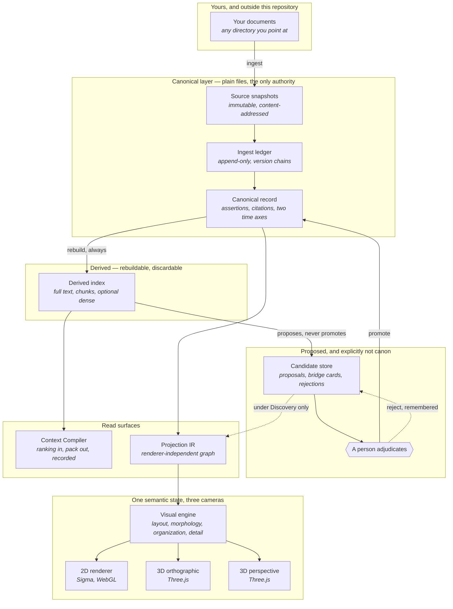
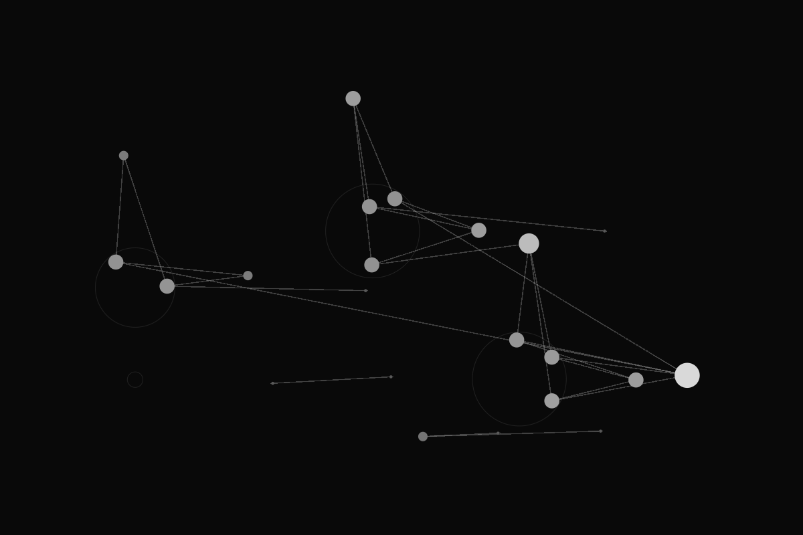
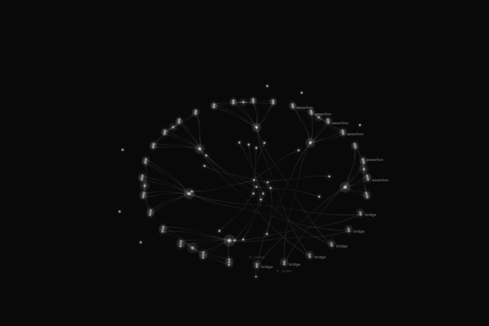

# NousOS

**A local-first knowledge system whose canonical layer is plain files.**

NousOS keeps what you know in files you own, records where every claim came
from and when it was true, and refuses to make anything canonical without you.
It compiles context deterministically, and it draws the resulting knowledge
graph in 2D and 3D from one shared semantic projection.

**V1 engine complete.** Personal knowledge data is attached separately and never
lives in this repository.


<sub>A public synthetic fixture, drawn by the Three.js renderer. Every image in
this document is generated from `fixtures/synthetic/` — see
[the visual system](#the-visual-system).</sub>

---

## Why it exists

A note-taking application stores text. A retrieval-augmented chat application
turns text into an answer. Neither of them can tell you **where a claim came
from, when it stopped being true, or what it now contradicts** — and neither
will admit when it does not know.

NousOS is built the other way round. Provenance, time and human authority are
not features layered on a search index; they are the record, and everything else
is derived from it and can be thrown away.

The problem it solves is the one that shows up after a few years of notes: you
have thousands of statements, some of them stale, several of them mutually
inconsistent, most of them unattributed, and no way to ask *which of these is
still true, and how do I know?*

## What it is, and what it is not

**It is** a library and two local transports over a canonical layer of plain
files: identity, provenance, versioning, a rebuildable index, temporal
reasoning, a human-gated candidate layer, and renderer-independent projections
of the resulting graph, with three renderers that draw them.

**It is not** any of the following, and no part of this repository claims to be:

- **Not a hosted service, a daemon, or anything that opens a network socket.**
  Both transports are local: a command line and a stdio JSON-RPC server.
- **Not a chat product, and not an agent.** It publishes operations; it does not
  decide when to call them.
- **Not a system that writes to your canon.** Nineteen operations ship. Sixteen
  are read-only and three record proposals apart from canon. **None of them can
  promote anything into canon** — promotion is a separate human act.
- **Not a retrieval breakthrough.** [`docs/CAP-15-RETRIEVAL.md`](docs/CAP-15-RETRIEVAL.md)
  reports what was measured, including where the numbers are poor and where a
  planned comparison could not be run at all.
- **Not a general-purpose graph visualisation library.** The visual layer draws
  this project's own projections.

## The principles the code is tested against

These are constraints with tests behind them, not aspirations.

- **Canon is files.** Every database NousOS builds is reconstructible from the
  canonical file layer alone. Deleting the derived store loses nothing.
- **The data root is configuration.** No machine path and no personal identifier
  appears in product code. NousOS reads the corpus you point it at, and it has
  no opinion about where that is.
- **Unknown is a third answer.** A check that did not run is never recorded as
  one that passed, and an absent measurement is never reported as zero.
- **Nothing becomes canonical because a machine produced it.** Generated
  material lands in a candidate layer and is promoted only by a person.
- **The names are part of the product.** What each concept is called, and which
  concepts earned a name from the vocabulary of knowledge rather than of
  software, is written down in [`docs/VOCABULARY.md`](docs/VOCABULARY.md) and
  checked against the code by the test suite.
- **No complexity without evidence.** A new mechanism needs a named failure
  mode, a reproducible test, and an observed win before it earns a place.

---

## How knowledge moves through it



**The arrow that matters is the one from `A person adjudicates` to the canonical
record.** It is the only way into canon, and no shipped operation can traverse
it.

### Canonical, and derived

| | Canonical | Derived |
|---|---|---|
| What it is | plain files: snapshots, an append-only ledger, the assertion record | an index built from them |
| Who may write it | a person, through adjudication | the rebuild, and nothing else |
| If you delete it | you have lost knowledge | you have lost nothing |
| Reproducibility | it is the source of truth | rebuilding produces **the same bytes**, not merely the same answers |

If a rebuild could differ between runs, something in the index came from
somewhere other than your files, and nobody would know what. A rebuild refuses
rather than quietly indexing around a gap.

### How human authority works

Authority is a **tier fixed when the process starts**, and it never widens.

- The default grant is **read-only**. A `tools/call` naming one of the three
  proposal operations is refused with `NotAuthorized` rather than served.
- Raising it is an explicit argument (`--tier`) at launch. No message, argument
  value or client identity can change it afterwards.
- **No tier promotes anything.** `candidate.propose`, `candidate.discover` and
  `candidate.adjudicate` record proposals, judgements and rejections in the
  candidate store; the promotion itself is a human act outside the operation
  catalogue.
- A rejection is **remembered**. Rejecting a proposal is a recorded fact with
  its own valid time, not a deletion, so the same suggestion cannot quietly
  return as new.

### Reliability and Discovery

A projection is produced under a policy that decides **what is left out**:

- **Reliability** admits sources, subjects, assertions and conflicts, and only
  claims whose validity is established.
- **Discovery** admits everything — all seven node kinds, all temporal answers
  including undetermined, all rubric dispositions, and all three epistemic
  classes.

**The difference is omission, not interpretation.** Discovery does not find
anything that Reliability hides; it declines to hide it. The same underlying
state produces both, and one is re-derivable from the other. "Reliability" does
not mean the omitted material is unreliable — a speculative link is *typed* as
speculative and an undetermined interval is *typed* as undetermined. The
narrower view is narrower, not truer.

Both are **internal policy identifiers** today. No user-facing surface in this
repository shows either word to a person;
[`docs/VOCABULARY.md`](docs/VOCABULARY.md) records the recommendation for the
labels if one is ever built, and says plainly that it is a recommendation.

### Time, and provenance

**Two axes, never collapsed.** Valid time is when a claim was true of the world.
Recording time is when this system learned it. Asking *what did I believe last
March about what was true in 2019* is two different questions and NousOS keeps
them apart.

- **Supersession** is recorded, not applied. A later assertion about the same
  subject does not delete the earlier one; the history is returned oldest-first
  and you can see the shape of the change.
- **Disagreement stays visible.** Connected contradictions are reported as
  conflicts with their members. Nothing picks a winner.
- **A rejection begins when it was made**, not when the thing it rejects began.
- **Support is a typed class, not a number.** There is no confidence score
  anywhere, because a scalar invites arithmetic over evidence.
- **Provenance is exact.** A citation names a snapshot and a byte range, and
  `provenance.span` reads the quoted text back out of the snapshot it cites, so
  a quotation can be checked rather than trusted.
- **Identity is minted independently of content.** Correcting a typo does not
  rename the thing; the content digest is exactly a function of content, so an
  edit is detectable.

### Two transports, one catalogue

Every operation `core.py` publishes is reachable through **both** the `cli.py`
command line and the `mcp.py` stdio JSON-RPC server, shaped like the Model
Context Protocol's `initialize` / `tools/list` / `tools/call` trio.

Neither hand-writes its own operation list. Both are generated by walking the
same catalogue, so what one surface offers **cannot drift** from what the other
does by having been typed twice. Once serving begins, stdout carries nothing but
JSON-RPC messages; everything else goes to stderr.

[`docs/INTEROPERABILITY.md`](docs/INTEROPERABILITY.md) is the whole contract,
including how a client should be configured.

`artifact.py` reads and writes a **portable proposal artifact**: a file a
separate process — including one with no access to your canon — can produce, and
which this system accepts as a *proposal* and never as authority. An artifact
that arrives carrying a claim to authority is refused rather than downgraded.

---

## The visual system

**There is one semantic Projection IR.** 2D, 3D orthographic and 3D perspective
are three projections of the same knowledge state — not three products, and not
three sources of truth.

|  |  |
|---|---|
|  |  |
| **2D** — Sigma, over WebGL. Builds its own render model. | **3D orthographic** — Three.js, shared scene model. |
|  |  |
| **3D perspective** — the same scene, a different camera. | **Focused** — the camera moved; the knowledge state did not. |

**Renderer choice does not own semantics.** The visual layer is split so that
meaning and drawing cannot leak into each other: the engine holds nothing
specific to a rendering technology, and a renderer is handed a much smaller view
of the graph than the one the engine has — with what it reads recorded, so that
reading too much is detectable rather than merely discouraged. A check over the
two Three cameras' own source refuses literal colours, literal material
assignments, and imports of the modules that would let them resolve visual
policy themselves.

### Presentation axes, and what stays semantic

**Morphology, organization, level of detail and colour are presentation.** They
change how the same state looks and they change nothing about what it means.

|  |  |  |
|---|---|---|
| Stellar | Neural | Mycelium |

*One graph, one projection, three morphologies.*

|  |  |
|---|---|
| Flat organization | Aggregate windows over the **same** graph — not a different graph |

**Provenance, temporal state, contradiction, and candidate / rejected /
superseded status remain semantically grounded.** They come from the projection,
they are typed, and a renderer cannot invent or suppress them. The node
vocabulary is closed — `source`, `subject`, `cluster`, `assertion`, `conflict`,
`bridge`, `rejection` — and so is the relation vocabulary, and **no relation
selects a preferred claim**.

Two rules the visual layer is measured against:

- **Stable layouts.** Positions are derived deterministically, so the picture you
  built a mental map of is the picture you get back. A layout that reshuffled on
  every load would make the map worthless.
- **Critical meaning is never carried by colour alone.** Anything that matters
  epistemically is also carried by a form, a label or a structural difference.

### What is not claimed

- **3D is not claimed to be cognitively superior**, and the fact that it exists
  is not an argument that it is. The controlled comparison in
  [`docs/CAP-14-COMPARISON.md`](docs/CAP-14-COMPARISON.md) reports **all twenty
  machine-instrument comparisons as not comparable**, three preregistered
  task-correctness dimensions as not tested because they were never built, and
  human cognition as not tested. No winner, and none was required.
- **A separate spike qualified a WebGPU/TSL node-material direction as a
  plausible future architecture, and it was deliberately not retrofitted into
  V1.** Nothing in this repository depends on it, nothing here uses it, and its
  evidence is not published here. It is mentioned so that its absence reads as a
  decision rather than an oversight.

[`docs/RENDERER-COMPARISON.md`](docs/RENDERER-COMPARISON.md) records what the
implementation demonstrated, and where the evidence cannot support a comparison
it says so instead of estimating one.

---

## Your data stays outside this repository

**NousOS never stores your knowledge inside its own source tree, and this
repository has never contained any.** The separation is physical, not merely a
matter of `.gitignore`:

- Every store location is **configuration you supply**. NousOS resolves seven of
  them and **refuses to start if one is missing** rather than guessing a default.
  A knowledge system that invents a location writes your data somewhere you did
  not choose.
- `fixtures/synthetic/` holds small, wholly invented documents used by the tests
  and by every image in this document. They contain no personal material and are
  safe to read, copy and publish.
- The derived index is rebuildable and is never committed; `.gitignore` refuses
  `*.db`, `*.sqlite` and `*.sqlite3`.
- A test in the suite refuses any absolute machine path, personal identifier or
  credential in tracked file content or names, and it runs in continuous
  integration on every push.
- The retrieval measurement in `docs/CAP-15-RETRIEVAL.md` was taken over a
  private corpus that is **not** in this repository: what ships is the aggregate
  result and opaque cell identifiers, never a document, a title, a path or a
  quotation.

If you point NousOS at a private corpus, that corpus stays where you put it. The
only thing this repository holds is the software that reads it.

---

## What V1 implements

| Area | State |
|---|---|
| Package skeleton and version surface | present |
| Data-root resolution from configuration | present |
| Public synthetic fixtures | present |
| Canonical record: identity, content hashing, provenance | present |
| Immutable source snapshots | present |
| Ingestion: append-only ledger, versioning, invalidation | present |
| Source memory: provider export ingest, identity kept across re-import, per-export sightings | present |
| Source memory: a second export format (sharded conversation mappings) with asset records — identity, digest and provenance of exported files, their bytes left in the archive | present |
| Derived index, rebuildable from the files alone | present |
| Measuring instrument and cross-language baseline | present |
| Context compilation, with a measured default | present |
| Authority boundary for governed operations | present |
| Candidate lifecycle, discovery rounds, human adjudication | present |
| Two time axes, supersession, visible disagreement | present |
| Renderer-independent projections of the graph | present |
| Visual engine over those projections | present |
| 2D renderer (Sigma, WebGL) | present |
| 3D renderer (Three.js / React Three Fiber), orthographic and perspective | present |
| Controlled comparison of the three renderers | present, [`docs/CAP-14-COMPARISON.md`](docs/CAP-14-COMPARISON.md) |
| Semantic retrieval, measured and reported honestly | present, opt-in, [`docs/CAP-15-RETRIEVAL.md`](docs/CAP-15-RETRIEVAL.md) |
| Vocabulary: the two registers of names, and the map between them | present, [`docs/VOCABULARY.md`](docs/VOCABULARY.md) |
| Command-line and stdio JSON-RPC interfaces | present, [`docs/INTEROPERABILITY.md`](docs/INTEROPERABILITY.md) |

**What ingestion guarantees.** Taking a source in twice changes nothing the
second time, and a version is recorded only when the bytes actually differ. The
history of a source is a plain append-only file, so recovering it means reading
it. Content that arrives from a source is held in its own type that cannot stand
in for text this project wrote — text that reads as an instruction is labelled
and still stored, because refusing it would quietly lose part of your corpus.

**What source memory adds.** An export from an assistant service is taken in as
*evidence that the provider exported it*, one source per provider record — a
conversation, each of its messages, a project, a memory file — and each keeps
the same identity the next time the same export, or a later one, is taken in.
A title change is one new version of one record; an unchanged message is
recorded as unchanged; a record missing from a later export is not deleted;
the same export twice writes nothing the second time. Which export carried
which version is written down separately from the content, so a re-export is
not a revision. The adapter recognises a format by the shape of its files,
never by their names, and the provider is a string read from the export
rather than a word in the code. A second adapter reads exports that split a
conversation list into shards of node mappings and point at exported files:
each file becomes an asset record — its identifier, digest, detected type,
given name and the messages that point at it — while its bytes stay in the
archive, never in a snapshot. Nothing in it is canonical, and no shipped
operation reaches it.

**How context is assembled.** A pack is built from a ranking, and every pack
records what went into it — reproducibly, so the same inputs always yield the
same record. Which assembly strategy is the default was decided by measurement
rather than preference: of six families, five were measured and none beat the
plain one, so the plain one stayed. The sixth could not be measured at all on
that corpus and is recorded as unmeasured rather than as a tie, because those
are different facts. Two numbers are always reported apart — whether both
documents of a pair made it in, and whether the specific passages that ground
the claim made it in — because reading the first as evidence about the second is
a mistake that has already been made once here, and it took real work to notice.

**How results are measured.** The instrument is built before the things it
judges, so it cannot be shaped by the answers it later reports. Expected results
are written down from reading the documents, never recorded from a run — a
golden file regenerated from the code it constrains cannot fail. Relating terms
across languages is a pluggable layer with no default, because the fixed
hand-written table is *measured* insufficient and its proposed replacement is
unmeasured, and preferring an unmeasured design to a measured-poor one is still
a guess.

---

## Requirements

**Python 3.11 or newer** for the package. It has **no third-party runtime
dependencies**: `import nous_os` works with nothing else installed.
`nous_os.semantic` is the one exception and is opt-in behind the `semantic`
extra, so a clean install stays dependency-free unless a caller asks for dense
retrieval.

**Node.js 24 or newer, with npm**, for `ui/` — the visual engine and the three
renderers, which are about half this repository by file count. The suites there
are developed against Node 24.11 and npm 11.6. The Python package does not
import any of it, and you can ignore `ui/` entirely if you only want the library.

## Run

No installation step is required. From a clone:

```bash
PYTHONPATH=src python3 -m nous_os --version
```

Installing the package works too and nothing here depends on it:

```bash
python3 -m pip install .
```

## Quickstart

**NousOS resolves seven store locations and refuses to start if any is missing.**
The shortest way to a working instance is to point the data root at the public
synthetic corpus and give the other six a scratch directory:

```bash
WORKSPACE="$(mktemp -d)"                       # any directory you choose
mkdir -p "$WORKSPACE/snapshots"

export PYTHONPATH=src
export NOUS_OS_DATA_ROOT=fixtures/synthetic/corpus
export NOUS_OS_SNAPSHOT_ROOT="$WORKSPACE/snapshots"
export NOUS_OS_LEDGER_PATH="$WORKSPACE/ledger.jsonl"
export NOUS_OS_DERIVED_PATH="$WORKSPACE/derived.sqlite3"
export NOUS_OS_CANDIDATE_STORE_PATH="$WORKSPACE/candidates.jsonl"
export NOUS_OS_BRIDGE_REGISTRY_PATH="$WORKSPACE/bridges.jsonl"
export NOUS_OS_REJECTION_MEMORY_PATH="$WORKSPACE/rejections.jsonl"

python3 -m nous_os system.capabilities
python3 -m nous_os system.health
```

Every location also has a command-line option (`--data-root`, `--snapshot-root`,
and so on) if you would rather not use the environment. `system.health` reports
each location as `healthy`, `absent` or `unknown` — never as a silent zero.

### The stdio JSON-RPC transport

The same catalogue, over the Model Context Protocol's message shape. A client
launches the module and speaks JSON-RPC on stdin and stdout:

```bash
printf '%s\n' \
  '{"jsonrpc":"2.0","id":1,"method":"initialize","params":{}}' \
  '{"jsonrpc":"2.0","id":2,"method":"tools/list","params":{}}' \
  '{"jsonrpc":"2.0","id":3,"method":"tools/call","params":{"name":"system.health","arguments":{}}}' \
  | python3 -m nous_os.mcp
```

---

## Tests

This is the whole of it, and it is the same command continuous integration runs:

```bash
python3 -m pip install pytest ".[semantic]"
npm --prefix ui ci
python3 -m pytest tests/ -q --ignore=tests/test_semantic.py --ignore=tests/test_semantic_controls.py
npm --prefix ui run typecheck
```

Three things in that recipe are load-bearing, and each of them was measured
rather than assumed.

**The two `--ignore` arguments are not optional and not a skip.**
`tests/test_semantic.py` and `tests/test_semantic_controls.py` need two ONNX
checkpoints already present in a local Hugging Face cache. Resolution passes
`local_files_only`, so nothing is ever downloaded. They are excluded by name,
with the reason stated, rather than made to look green.

**The `semantic` extra is needed even though those two modules are excluded.**
`nous_os.semantic` imports NumPy, ONNX Runtime, `tokenizers` and
`huggingface_hub` at module level, and three tests elsewhere walk *every* module
in the package — checking that no public callable can construct a human
decision, that a reference walk refuses anything it cannot analyse, and that no
provider name reaches a public identifier. Without the extra those three fail
for a reason that has nothing to do with your change. With only `pytest`
installed and no `--ignore`, **pytest aborts during collection and nothing runs
at all.**

**`npm --prefix ui ci` is not optional either.** Five tests in
`tests/test_vocabulary.py` check a published document against the renderer's own
resolved values by bundling the TypeScript that produces them, rather than by
reimplementing the arithmetic in Python. Without `ui/node_modules` those five
**fail** with a stated reason — they do not skip and they do not pass.

Some tests exist to keep the repository honest rather than to check behaviour:
one refuses any absolute machine path, personal identifier or credential in
tracked file content or names; one proves the data root really is configuration
by running the same operation against two different roots; one proves the
package imports and works with no external tree present; and one asserts the
commit-message contract in [`CONTRIBUTING.md`](CONTRIBUTING.md) over **every
commit in this repository's history**.

### What continuous integration proves

The workflow in [`.github/workflows/ci.yml`](.github/workflows/ci.yml) runs on
every push and pull request, from a clean checkout with no local state.

**It proves** that a fresh clone on Linux, on the declared Python floor and on a
current Python, with only public dependencies installed:

- installs and imports the package;
- passes the clean-clone-reproducible Python suite;
- passes the TypeScript typecheck;
- passes the public-safety test that refuses machine paths, personal
  identifiers and credentials in tracked files;
- satisfies the commit-message contract across the **whole** history.

**It does not prove**, and does not pretend to:

- **the browser and GPU evidence.** The suites under `ui/test/browser/` need
  Playwright browsers and a real GPU adapter. They are what produce `ui/dist/`,
  which is run output and is deliberately not committed.
- **`npm --prefix ui run test:unit`.** From a clean clone **461 of 477 pass and
  16 fail**; all sixteen read generated evidence under `ui/dist/`. A document
  generated from an artifact is checked against that artifact rather than
  against a copy of its numbers, so without the artifact the check refuses
  instead of passing vacuously.
- **six visual acceptance criteria** that a person discharges
  by looking at rendered images. No public substitute for that judgement exists, and inventing
  one would make six criteria pass against something nobody judged.
- **semantic retrieval.** See below.

Running a check that cannot succeed in order to display a skip would make the
badge mean less than it does now.

### What does not run from a public clone

Each of these fails with a stated reason rather than reporting a pass.

**`tests/test_semantic.py` and `tests/test_semantic_controls.py`** need the
`semantic` extra (`pip install .[semantic]`) *and* the two ONNX checkpoints
`semantic.py` names already present in the local Hugging Face cache. Resolution
passes `local_files_only`, so it never contacts the network and never downloads.
Measured with the extra installed and an empty cache: **15 failed, 8 errors,
1224 passed**. Obtaining weights is a separate, deliberate human act, and
continuous integration does not perform it.

**The browser suites** under `ui/test/browser/` need Playwright browsers
installed and a real GPU adapter, and they are what produce `ui/dist/`. They are
not part of either default run.

**The documentation images** in `docs/assets/` are regenerated from the public
fixtures by `node --experimental-strip-types tools/capture-docs-assets.ts`, run
from `ui/`. It needs Playwright's chromium. `docs/assets/MANIFEST.json` records
the fixture, its digest and each image's digest, so a published figure can be
traced to the public data it came from.

---

## Layout

```
src/
└── nous_os/
    ├── __init__.py       the version surface
    ├── __main__.py       the process entry point, delegating to cli.py
    ├── config.py         data-root resolution
    ├── identity.py       stable ids and content hashing
    ├── snapshots.py      immutable, content-addressed source snapshots
    ├── provenance.py     citations, byte-range locators, quote-lint
    ├── canonical.py      the assertion record
    ├── untrusted.py      the boundary around content from outside
    ├── ledger.py         append-only ingest record and version chains
    ├── sources.py        source memory: provider records, the identity each keeps, where it was seen
    ├── assistant_export.py
    │                     one export format, classified by shape; the provider is read, not named
    ├── mapping_export.py
    │                     a second format: sharded conversation mappings and the assets they point at
    ├── derived.py        the rebuildable index over everything above
    ├── aliases.py        interchangeable ways of relating terms across languages
    ├── measure.py        the measuring instrument, and its third answer
    ├── chunking.py       pieces of a document that remember where they came from
    ├── semantic.py       a derived, offline dense index over chunks, and its third answer
    ├── compile.py        assembling a pack, and recording what went into it
    ├── ablation.py       comparing assembly strategies without combining the numbers
    ├── capability.py     four kinds of authority, and the one door they are checked at
    ├── candidates.py     append-only proposals that are explicitly not canon
    ├── temporal.py       two time axes, supersession, and disagreement kept visible
    ├── attribution.py    a claim key that carries where it came from
    ├── adjudication.py   the human-gated boundary between a proposal and canon
    ├── discovery.py      bridge candidates, gates, and append-only rounds
    ├── projection.py     renderer-independent knowledge graph projections
    ├── operations.py     registration of the project's governed operations
    ├── core.py           the one application service boundary
    ├── cli.py            the command-line transport, generated from the catalogue
    ├── mcp.py            the stdio JSON-RPC transport, generated from the catalogue
    └── artifact.py       the portable proposal artifact; refused if it carries authority
ui/
├── src/
│   ├── adapter/          projections read into the visual model, meaning kept sealed
│   ├── engine/           renderer-independent visual model, layout, and the axes
│   │                     of presentation: morphology, organization, detail, colour
│   ├── scene/            every material, geometry, label and interaction value,
│   │                     resolved once and handed to whichever renderer draws it
│   ├── render2d/         the Sigma renderer, over WebGL; resolves its own model
│   ├── render3f/         the Three.js / React Three Fiber renderer, orthographic
│   │                     and perspective, over the shared scene model
│   └── comparison/       the controlled analysis across the three renderers
├── test/                 unit, scene, renderer and browser-evidence suites
└── tools/                documentation capture; not part of any suite
tools/                    the commit-message contract, as an executable check
tests/                    the Python suite described above
benchmarks/               the measuring instrument's own reporting scripts
docs/
├── VOCABULARY.md              the technical and epistemic registers, and the map
│                              between them; checked against the code by the suite
├── INTEROPERABILITY.md        the Core contract and its two transports
├── RENDERER-COMPARISON.md     three renderers over one semantic state
├── CAP-14-COMPARISON.md       the 2D/3D controlled comparison, generated from evidence
├── CAP-15-RETRIEVAL.md        the retrieval measurement, including what did not run
├── cap15-retrieval-artifact.json
│                              the artifact that measurement is generated from, so the
│                              document can be checked against it rather than trusted
└── assets/                    the images in this document, and their manifest
fixtures/
└── synthetic/
    ├── MANIFEST.jsonl    path and content digest per document
    ├── GOLDEN.md         what a correct search must return, and why
    ├── DISCOVERY.md      published candidate-lifecycle and discovery expectations
    ├── corpus/           public, invented test documents
    ├── bilingual/        the same subjects in two languages
    ├── injection/        text that reads as an instruction, for the boundary tests
    ├── export/           an invented assistant export, its files deliberately misnamed
    ├── mapping-export/   an invented sharded conversation-mapping export, text files standing in for assets
    └── projection/       fixed graphs the visual layer is measured against
```

## Contributing

[`CONTRIBUTING.md`](CONTRIBUTING.md) covers how to run the checks and the one
contract this project is strict about: every commit message has the same shape,
and it is enforced mechanically over the whole history.

## License

MIT. See [`LICENSE`](LICENSE).
