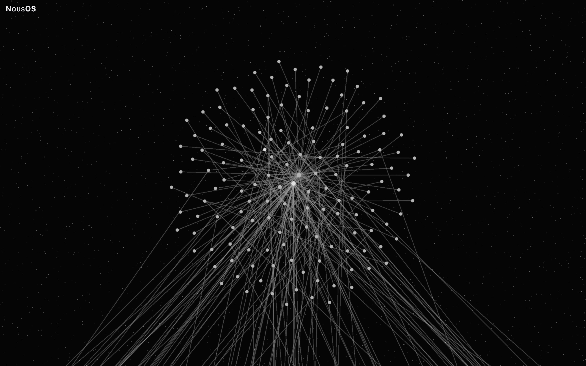
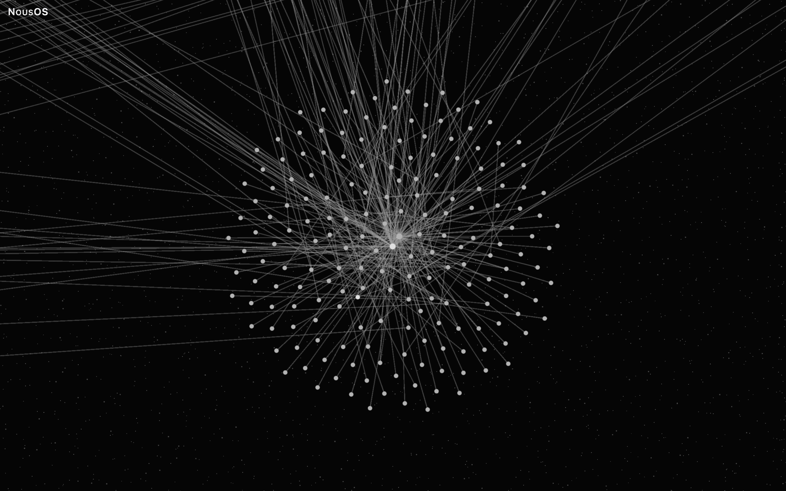
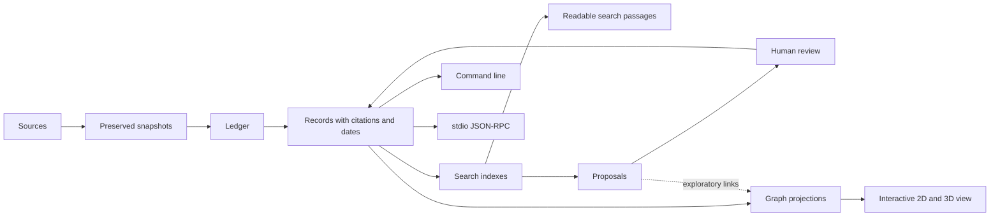

# NousOS

A knowledge system that keeps every statement connected to its source, its history and its relationships, and lets you explore them as an interactive 2D or 3D graph.

[](docs/assets/gallery/natural-stellar-3d-complete.jpg)

*The Natural arrangement in 3D at Complete density, drawn from invented demo data.*

## What it is

NousOS is a tool for keeping useful knowledge together with where it came from. It helps people search notes and documents, check the source behind a statement, and explore how pieces of knowledge relate to one another.

A search result is more than a line of text. Each quotation points to the exact bytes in an unchanged copy of its source. That makes it possible to check the wording against the original. A claim can also say when it was true and when it was learned. Older versions remain in its history. A suggestion does not become accepted knowledge until a person reviews and approves it.

The same knowledge can be explored as an interactive graph. You can view it in two or three dimensions, choose different arrangements and node styles, and adjust how many nodes appear—from a light overview to every node. The graph is another way to explore the cited records, not a replacement for their sources.

## Why it matters

Information often gets separated from its evidence. A note may repeat a statement without its source, lose the date when it applied, or hide a later correction. Search can also return a fragment that is hard to interpret without its surrounding passage. These gaps make it difficult to check what is known and how it changed.

NousOS helps close those gaps: each statement keeps its source, its dates and its history, so it can be checked rather than taken on trust.

Bringing memory and visual exploration together is the point: the graph shows clusters and possible connections at a glance, and the records in it still lead back to their sources. That makes NousOS useful both for finding evidence and for seeing the shape of a body of knowledge.

## What you can do

- Add source material and create records that quote or refer to it.
- Search for readable passages and retrieve context around a result.
- Check a quotation against the exact source bytes it cites.
- Keep track of when a claim applied, when it was learned, and how it changed.
- Review proposed knowledge before approving it.
- Explore the same records in an interactive 2D or 3D graph.
- Change the graph arrangement (called a topology), node style, and density.
- Use the command line, a standard input/output JSON-RPC interface, or the browser review page.

The repository includes invented sample material, not a private corpus. Files stay where configured. The command line and JSON-RPC interface do not open a network listener; the demo page is served locally.

### Key terms

- **Citation:** a reference to a specific span of source text. Its byte range can be checked against the unchanged snapshot.
- **Snapshot:** a preserved copy of a source as it was captured. Later changes to the original do not rewrite that copy.
- **Attested connection:** a graph link supported by cited records. **Exploratory connection:** a possible relationship shown for investigation, with an explanation; it is not source evidence.
- **Proposal and review:** a suggested record or change that a person examines and either approves or declines.
- **Topology:** the rule or arrangement used to place graph nodes. The project offers several arrangements, including experimental ones.
- **Density:** how many nodes the view draws. A light setting gives an overview; Complete aims to show all nodes, and Custom lets you choose a count.

## Gallery

The interface labels are Italian: «Essenziale» means Essential, «Bilanciata» means Balanced, «Completa» means Complete; «Attestata» means Attested and «Esplorativa» means Exploratory.

The gallery uses invented demo data. Each overview is centred, with its drawn graph (nodes, relations and visible guides, not the background stars) filling about 80–90% of the frame's limiting dimension. Paired images use the same orientation, and each density is framed on its own nodes: Balanced has its own layout, 7–10× more compact than Complete in these captures, measured from the manifest's layout bounds.

### Natural · Stellar overviews

| View | Balanced | Complete |
|---|---|---|
| 2D | [](docs/assets/gallery/natural-stellar-2d-balanced.jpg) | [](docs/assets/gallery/natural-stellar-2d-complete.jpg) |
| 3D | [](docs/assets/gallery/natural-stellar-3d-balanced.jpg) | [](docs/assets/gallery/natural-stellar-3d-complete.jpg) |

### Explore at different scales

Each close-up is centred on one cluster through the page's own camera, after the render stabilised; nothing is cropped or enlarged, and the density, counts and camera of every view are recorded in the manifest. At Balanced a cluster's nodes are spread across the compact Balanced layout, so the 2D close-ups use Custom with 2,000 nodes, where each cluster keeps its own disc.

[](docs/assets/gallery/natural-stellar-2d-custom-detail-links.jpg)

Natural · Stellar · 2D · Custom (2,000 nodes), centred on a small cluster: all 144 of its nodes and the relations leaving it.

[](docs/assets/gallery/natural-stellar-2d-custom-detail-cluster.jpg)

Natural · Stellar · 2D · Custom (2,000 nodes), centred on another cluster: all 187 of its nodes around its hub.

### Other topologies at Complete · experimental Geometry Lab

All images use synthetic demo data and the Stellar node style. Canopy, Sierpiński, Llull, and Julia are experimental topologies.

| Topology | 2D | 3D |
|---|---|---|
| Canopy | [](docs/assets/gallery/canopy-2d-complete.jpg)<br>Canopy · 2D · Complete | [](docs/assets/gallery/canopy-3d-complete.jpg)<br>Canopy · 3D · Complete |
| Sierpiński | [](docs/assets/gallery/sierpinski-2d-complete.jpg)<br>Sierpiński · 2D · Complete | [](docs/assets/gallery/sierpinski-3d-complete.jpg)<br>Sierpiński · 3D · Complete |
| Llull | [](docs/assets/gallery/llull-2d-complete.jpg)<br>Llull · 2D · Complete | [](docs/assets/gallery/llull-3d-complete.jpg)<br>Llull · 3D · Complete |
| Julia | [](docs/assets/gallery/julia-2d-complete.jpg)<br>Julia · 2D · Complete | [](docs/assets/gallery/julia-3d-complete.jpg)<br>Julia · 3D · Complete (tilted by a short drag and ×1.16 closer than the fitted view, where the relation bundles become visible) |

Capture method, render times, density counts, and size-coherence measurements are in [Gallery and measurements](docs/GALLERY-AND-MEASUREMENTS.md).

## Quickstart: public demo

You need Node.js 24 and Python 3.11 or newer. Run these commands from the repository root. The first two prepare the review page, the third creates an invented sample dataset, and the fourth starts a local web server.

```bash
npm --prefix ui ci
npm --prefix ui run build:review
node --experimental-strip-types demo/src/cli.ts synth --profile reference --seed 1 --out demo/out/reference
PYTHONPATH=src python3 -m nous_os.graph_review serve --graph demo/out/reference/dataset --port 8766
```

Open <http://127.0.0.1:8766/#experimental=fractal> in a browser. The page shows the generated knowledge graph; the URL enables experimental Geometry Lab arrangements. Without that flag, the page offers the standard Natural arrangement. The Python package has no third-party runtime dependencies. For a guided example of adding sources, searching, and checking citations, see the [memory walkthrough](docs/MEMORY-WALKTHROUGH.md).

## How it works

Source files are copied into snapshots, and an append-only ledger records captures and changes. Records keep citations and both time points: when a claim applied and when it was learned. Search indexes can be rebuilt. A person reviews proposals. Projections carry records into the graph view, where arrangement and density can change.



The 2D view is drawn with Sigma over WebGL, and the 3D view with Three.js and React Three Fiber. The graph view helps people inspect records and relationships. A layout guide can help arrange the drawing, but it does not add a source-backed connection. The command line and JSON-RPC interface use the same operations; neither turns a proposal into approved knowledge without review.

## Repository layout

The main folders and files are shown here; the code folders include a few representative entries, and the [repository layout](docs/REPOSITORY-LAYOUT.md) lists every Python module.

```text
nous-os/
├── .github/                              # CI configuration
│   └── workflows/ci.yml                  # Automated checks
├── benchmarks/                           # Benchmarking tools
├── demo/                                 # Synthetic demo and tests
│   ├── README.md                         # Demo instructions
│   ├── src/                              # Demo generator source
│   └── test/                             # Demo tests
├── docs/                                 # Guides and technical references
│   ├── assets/gallery/                   # Gallery images
│   ├── MEMORY-WALKTHROUGH.md             # Memory walkthrough
│   └── VERIFICATION-AND-LIMITS.md        # Evidence and constraints
├── fixtures/synthetic/                   # Invented example data
├── src/nous_os/                          # Python memory and search package
│   ├── cli.py                            # Command line
│   ├── graph_review.py                   # Graph review server
│   └── ledger.py                         # Knowledge history
├── tests/                                # Python test suite
├── tools/                                # Repository maintenance tools
├── ui/                                   # Interactive graph review app
│   ├── review/index.html                 # Browser entry page
│   └── src/                              # Graph and rendering code
├── .gitignore                            # Ignored local files
├── pyproject.toml                        # Python package settings
└── README.md                             # Project overview
```


## Limits

- **Node sizes and clicks, on synthetic data.** A browser test covered 60 combinations of arrangement, node style, 2D or 3D, and the nested grouping called Indra, on or off. All 60 reached Complete. In 46, node sizes stayed within 1% when the density changed; in the others the largest change was about twice the size (2D Canopy without Indra). Clicks selected the intended node 440 times out of 561; in dense views a click can select a neighbour.
- **Larger synthetic graphs.** On one machine, every arrangement also reached Complete in 3D on synthetic graphs of 15,000 and 20,000 nodes. This is one local measurement, not a performance guarantee.
- **A larger private graph.** On a private dataset larger than the demo, 54 of the 60 combinations opened and could be measured: five 3D views did not reach Complete within a 90-second test, and one 2D combination (Julia with Indra and the Neural style) is refused by design. Node sizes stayed within 1% in 40 of the 54. After choosing Complete on a large 3D view, the density control and the URL could update only after the drawing finished.
- **Display details.** Some arrangement guides can stay in an earlier position after the page fits the view, until the camera next moves. Nodes outside the camera can be clipped.
- **What was not checked.** Only Chromium was tested; touch screens, keyboard navigation inside the graph and screen readers were not. Six visual checks still need a person to judge the rendered images. The automated checks (CI) run the Python tests, the type check and the commit-message check, not the browser tests, which need a real graphics card. The semantic search tests need model files stored on your machine. More detail is in [verification and limits](docs/VERIFICATION-AND-LIMITS.md).

## Documentation

- [Memory walkthrough on a synthetic corpus](docs/MEMORY-WALKTHROUGH.md)
- [Gallery and measurements](docs/GALLERY-AND-MEASUREMENTS.md)
- [Verification and limits](docs/VERIFICATION-AND-LIMITS.md)
- [Vocabulary](docs/VOCABULARY.md)
- [Interoperability and transports](docs/INTEROPERABILITY.md)
- [Renderer comparison](docs/RENDERER-COMPARISON.md)
- [2D/3D comparison](docs/CAP-14-COMPARISON.md)
- [Retrieval measurement](docs/RETRIEVAL-MEASUREMENT.md)
- [Graph review export and page](docs/GRAPH-REVIEW.md)
- [Graph viewer](docs/GRAPH-VIEWER.md)
- [Candidate search](docs/CANDIDATE-SEARCH.md)
- [View architecture](docs/views/architecture.md)
- [View manual](docs/views/manual.md)
- [Geometry Lab](docs/views/GEOMETRY-LAB.md)
- [Deferred views](docs/views/deferred-views.md)
- [View limits](docs/views/limits.md)
- [Synthetic demo and dataset schema](demo/README.md)
