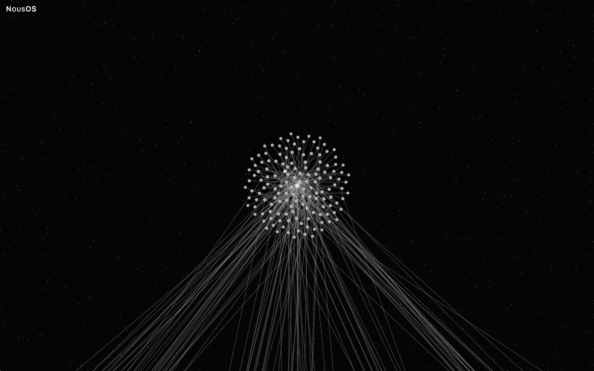
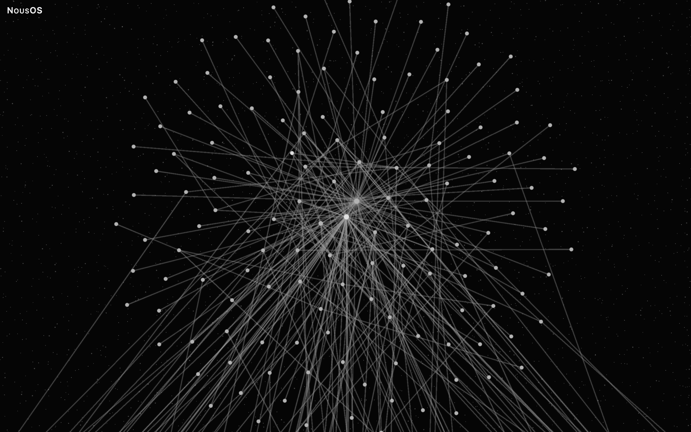
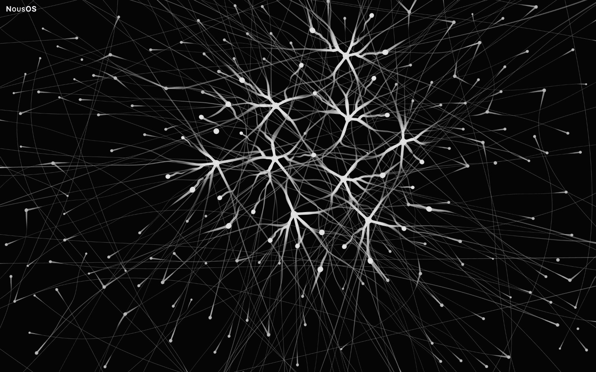
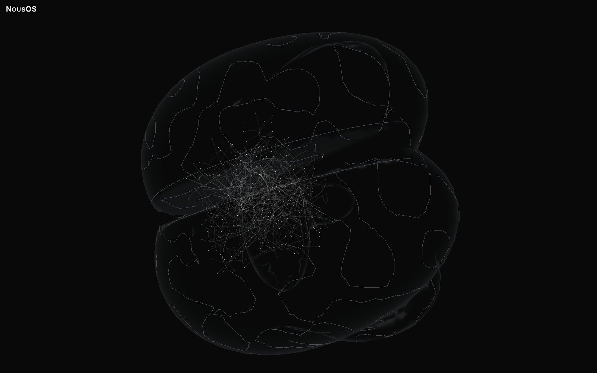
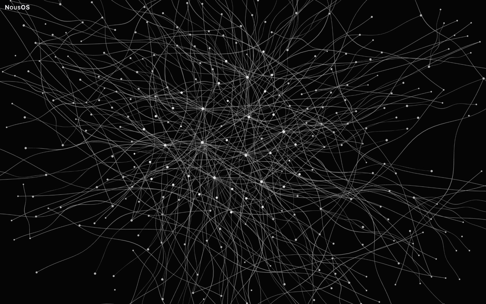
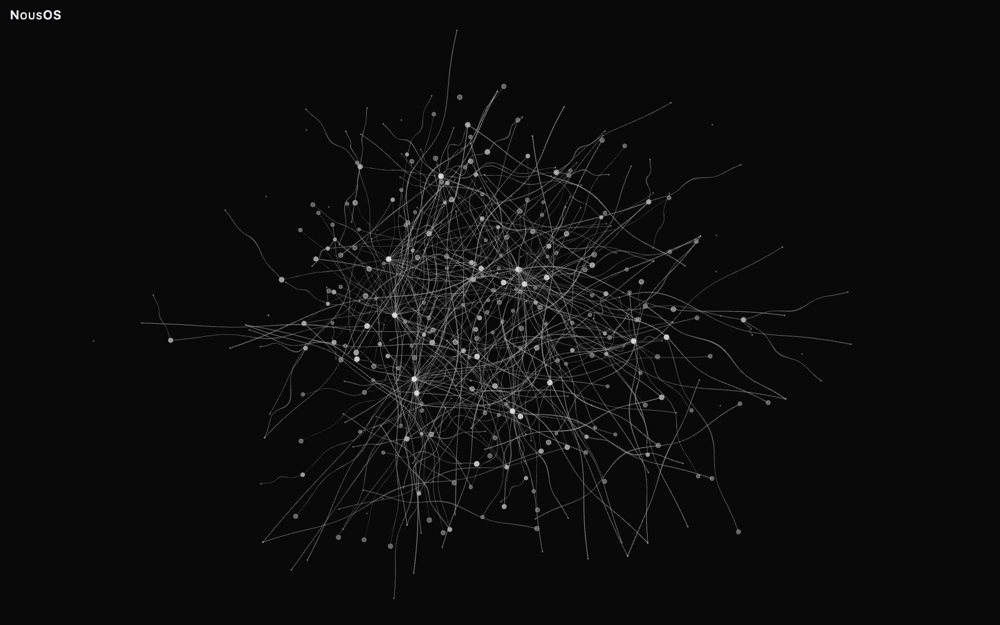
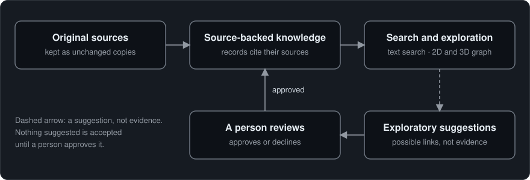

# NousOS

A knowledge system that keeps every statement connected to its source, its history and its relationships, and lets you explore them as an interactive 2D or 3D graph.

[](docs/assets/gallery/natural-stellar-3d-complete.jpg)

*The Natural arrangement in 3D at Complete density, drawn from invented demo data.*

## What it is

NousOS is a tool for keeping useful knowledge together with where it came from. It helps people search notes and documents, check the source behind a statement, and explore how pieces of knowledge relate to one another.

A search result is more than a line of text. Each quotation points to the exact bytes in an unchanged copy of its source. That makes it possible to check the wording against the original. A claim can also say when it was true and when it was learned. Older versions remain in its history. A suggestion does not become accepted knowledge until a person reviews and approves it.

The same knowledge can be explored as an interactive graph. You can view it in two or three dimensions, choose different arrangements and node styles, and adjust how many nodes appear—from a light overview to every node. The graph is another way to explore the cited records, not a replacement for their sources.

## Why it matters

Information often gets separated from its evidence. A note may repeat a statement without its source, lose the date when it applied, or hide a later correction. Search can also return a fragment that is hard to interpret without its surrounding passage. These gaps make it difficult to check what is known and how it changed.

NousOS helps close those gaps: each statement keeps its source, its dates and its history, so it can be checked rather than taken on trust.

Bringing memory and visual exploration together is the point: the graph shows clusters and possible connections at a glance, and the records in it still lead back to their sources. That makes NousOS useful both for finding evidence and for seeing the shape of a body of knowledge.

## What you can do

- Add source material and create records that quote or refer to it.
- Search for readable passages and retrieve context around a result.
- Check a quotation against the exact source bytes it cites.
- Keep track of when a claim applied, when it was learned, and how it changed.
- Review proposed knowledge before approving it.
- Explore the same records in an interactive 2D or 3D graph.
- Change the graph arrangement (called a topology), node style, and density.
- Use the command line, a standard input/output JSON-RPC interface, or the browser review page.

The repository includes invented sample material. Files stay where configured. The command line and JSON-RPC interface do not open a network listener; the demo page is served locally.

### Key terms

- **Citation:** a reference to a specific span of source text. Its byte range can be checked against the unchanged snapshot.
- **Snapshot:** a preserved copy of a source as it was captured. Later changes to the original do not rewrite that copy.
- **Attested connection:** a graph link supported by cited records. **Exploratory connection:** a possible relationship shown for investigation, with an explanation; it is not source evidence.
- **Proposal and review:** a suggested record or change that a person examines and either approves or declines.
- **Topology:** the rule or arrangement used to place graph nodes. The project offers several arrangements, including experimental ones.
- **Density:** how many nodes the view draws. A light setting gives an overview; Complete aims to show all nodes, and Custom lets you choose a count.

## Gallery

The interface labels are Italian: «Essenziale» means Essential, «Bilanciata» means Balanced, «Completa» means Complete; «Attestata» means Attested and «Esplorativa» means Exploratory.

The gallery uses invented demo data. Each overview is centred, and the graph fills most of the frame. Paired images use the same orientation; Balanced and Complete are each framed around the nodes shown.

### Natural · Stellar overviews

| View | Balanced | Complete |
|---|---|---|
| 2D | [](docs/assets/gallery/natural-stellar-2d-balanced.jpg) | [](docs/assets/gallery/natural-stellar-2d-complete.jpg) |
| 3D | [](docs/assets/gallery/natural-stellar-3d-balanced.jpg) | [](docs/assets/gallery/natural-stellar-3d-complete.jpg) |

### Explore at different scales

These real captures were made through the page's own camera, showing the same cluster from two distances. Nothing is cropped or enlarged, and the dataset, density, node style, palette and orientation stay the same. The pair uses a custom density of 2,000 nodes, where each cluster is drawn as a separate disc.

[](docs/assets/gallery/natural-stellar-2d-custom-scale-cluster.jpg)

Natural · Stellar · 2D · Custom (2,000 nodes): one cluster in context, with its 144 nodes at the centre and the relations that leave it for the rest of the graph, below the frame.

[](docs/assets/gallery/natural-stellar-2d-custom-scale-closer.jpg)

The same view about 3.8 times closer, at the same centre: single nodes, the cluster's hub and their links can be told apart. The cluster continues past the top and bottom edges.

### Morphologies

A morphology is the drawing style of nodes and relations. In Natural it also selects the arrangement, so each morphology has its own layout. All six views use the same synthetic dataset at Balanced (400 of 11,199 nodes), in the Natural topology with Indra off and the monochrome palette.

| Morphology | 2D | 3D |
|---|---|---|
| Stellar | [](docs/assets/gallery/natural-stellar-2d-balanced.jpg)<br>Stellar · 2D · whole graph | [](docs/assets/gallery/natural-stellar-3d-balanced.jpg)<br>Stellar · 3D · whole graph |
| Neural | [](docs/assets/gallery/natural-neural-2d-balanced.jpg)<br>Neural · 2D · closer view (×2.4) | [](docs/assets/gallery/natural-neural-3d-balanced-brain.jpg)<br>Neural · 3D · «Cervello» (Brain) on |
| Mycelium | [](docs/assets/gallery/natural-mycelium-2d-balanced.jpg)<br>Mycelium · 2D · closer view (×2) | [](docs/assets/gallery/natural-mycelium-3d-balanced.jpg)<br>Mycelium · 3D · whole graph |

The camera is adjusted for each node style. Stellar in both dimensions and Mycelium in 3D show the whole graph. Neural 2D and Mycelium 2D are closer views; Neural's branches are faint and Mycelium's threads merge together when viewed from farther away. Neural 3D shows the whole graph inside a decorative brain outline.

### Other topologies at Complete · experimental Geometry Lab

All images use synthetic demo data and the Stellar node style. Canopy, Sierpiński, Llull, and Julia are experimental topologies.

| Topology | 2D | 3D |
|---|---|---|
| Canopy | [](docs/assets/gallery/canopy-2d-complete.jpg)<br>Canopy · 2D · Complete | [](docs/assets/gallery/canopy-3d-complete.jpg)<br>Canopy · 3D · Complete |
| Sierpiński | [](docs/assets/gallery/sierpinski-2d-complete.jpg)<br>Sierpiński · 2D · Complete | [](docs/assets/gallery/sierpinski-3d-complete.jpg)<br>Sierpiński · 3D · Complete |
| Llull | [](docs/assets/gallery/llull-2d-complete.jpg)<br>Llull · 2D · Complete | [](docs/assets/gallery/llull-3d-complete.jpg)<br>Llull · 3D · Complete |
| Julia | [](docs/assets/gallery/julia-2d-complete.jpg)<br>Julia · 2D · Complete | [](docs/assets/gallery/julia-3d-complete.jpg)<br>Julia · 3D · Complete (tilted by a short drag and ×1.16 closer than the fitted view, where the relation bundles become visible) |

Capture method, render times, density counts, and size-coherence measurements are in [Gallery and measurements](docs/GALLERY-AND-MEASUREMENTS.md).

## Quickstart: public demo

You need Node.js 24 and Python 3.11 or newer. Run these commands from the repository root. The first two prepare the review page, the third creates an invented sample dataset, and the fourth starts a local web server.

```bash
npm --prefix ui ci
npm --prefix ui run build:review
node --experimental-strip-types demo/src/cli.ts synth --profile reference --seed 1 --out demo/out/reference
PYTHONPATH=src python3 -m nous_os.graph_review serve --graph demo/out/reference/dataset --port 8766
```

Open <http://127.0.0.1:8766/#experimental=fractal> in a browser. The page shows the generated knowledge graph; the URL enables experimental Geometry Lab arrangements. Without that flag, the page offers the standard Natural arrangement. The Python package has no third-party runtime dependencies. For a guided example of adding sources, searching, and checking citations, see the [memory walkthrough](docs/MEMORY-WALKTHROUGH.md).

## How it works

NousOS starts with original documents and notes, kept as unchanged copies. Source-backed knowledge consists of records that quote or cite those sources, so anyone can check a statement against the source it comes from; attested connections are backed by these records. People search those records and explore them in a graph to find related ideas. Exploratory connections are possible relationships suggested for investigation; they are shown separately from source-backed knowledge and are not evidence. Nothing suggested becomes accepted knowledge until a person reviews and approves it. For more detail, see the [memory walkthrough](docs/MEMORY-WALKTHROUGH.md) and [graph review guide](docs/GRAPH-REVIEW.md).

<picture>
  <source media="(max-width: 599px)" srcset="docs/diagrams/how-it-works-narrow.svg">
  
</picture>

## Repository layout

The main folders and files are shown here; the code folders include a few representative entries, and the [repository layout](docs/REPOSITORY-LAYOUT.md) lists every Python module.

```text
nous-os/
├── .github/                              # CI configuration
│   └── workflows/ci.yml                  # Automated checks
├── benchmarks/                           # Benchmarking tools
├── demo/                                 # Synthetic demo and tests
│   ├── README.md                         # Demo instructions
│   ├── src/                              # Demo generator source
│   └── test/                             # Demo tests
├── docs/                                 # Guides and technical references
│   ├── assets/gallery/                   # Gallery images
│   ├── MEMORY-WALKTHROUGH.md             # Memory walkthrough
│   └── VERIFICATION-AND-LIMITS.md        # Evidence and constraints
├── fixtures/synthetic/                   # Invented example data
├── src/nous_os/                          # Python memory and search package
│   ├── cli.py                            # Command line
│   ├── graph_review.py                   # Graph review server
│   └── ledger.py                         # Knowledge history
├── tests/                                # Python test suite
├── tools/                                # Repository maintenance tools
│   └── macos/                            # macOS tunnel kit and menu bar app
├── ui/                                   # Interactive graph review app
│   ├── review/index.html                 # Browser entry page
│   └── src/                              # Graph and rendering code
├── .gitignore                            # Ignored local files
├── pyproject.toml                        # Python package settings
└── README.md                             # Project overview
```


## Limits

- **Experimental features.** Geometry Lab arrangements (Canopy, Sierpiński, Llull and Julia), enabled by the `#experimental=fractal` URL flag, are experimental.
- **Dense views.** At high densities, a click can select a neighbouring node. Some node styles are hard to see from far away until you move closer, and in some arrangements node sizes change as the density changes. On a larger graph, a 90-second test could not confirm that five 3D views reached Complete, and after choosing Complete the density control and the URL may update only once drawing finishes. These performance observations come from one machine and are not a guarantee.
- **Compatibility and access.** Only Chromium on a desktop was tested. Touch screens, keyboard navigation inside the graph and screen readers have not been tested.
