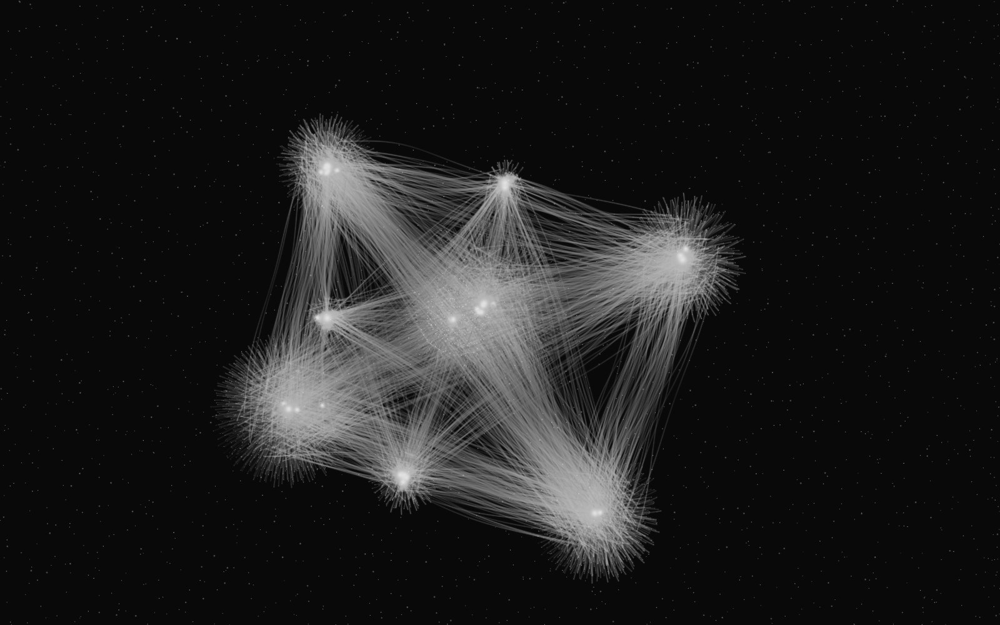
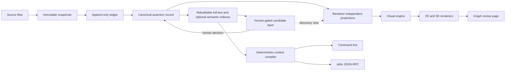
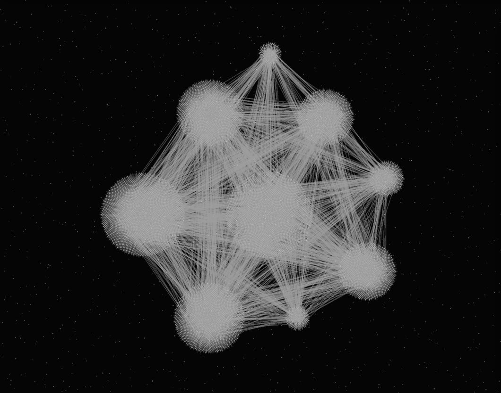
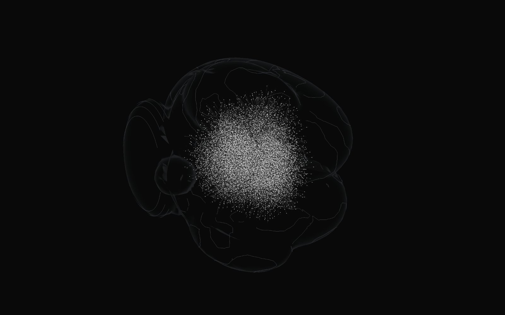
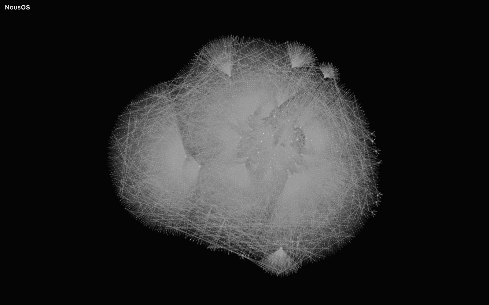
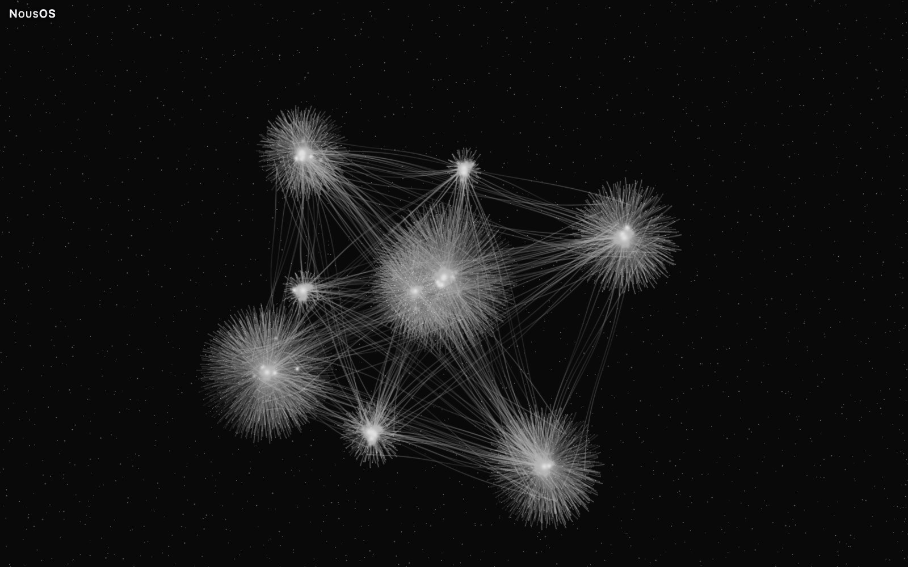
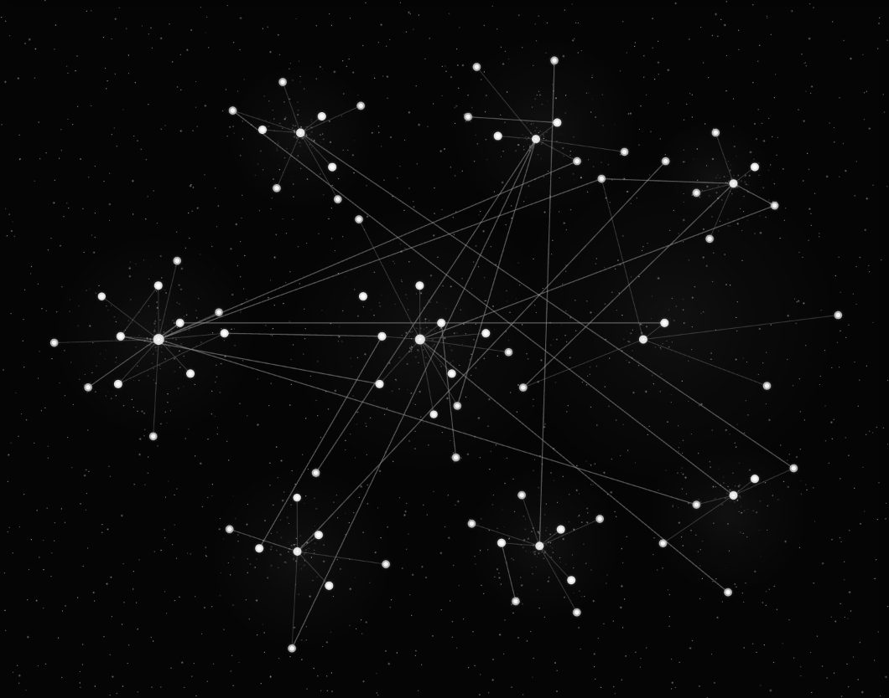
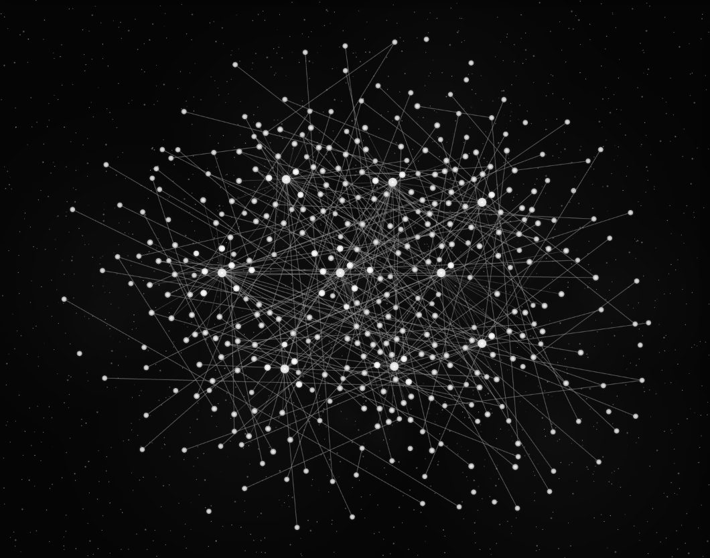
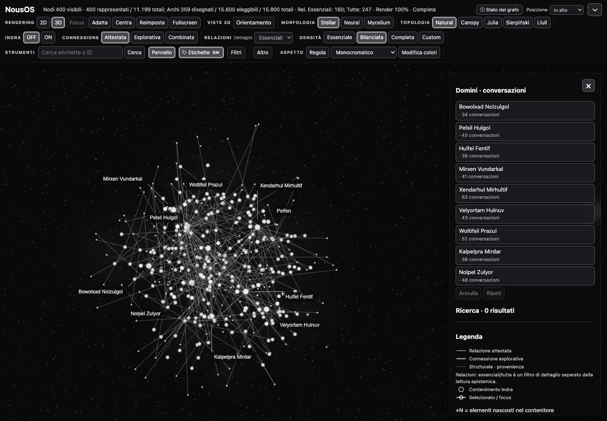

# NousOS

NousOS is a local-first knowledge system whose canonical layer is plain files. Every claim keeps its source, its valid and recorded time, and the human decision that admitted it; indexes and views are derived from that record. It compiles context deterministically and includes a graph review page that draws a knowledge graph in 2D and 3D.



Every image in this README is generated from the invented synthetic demo dataset.

## Why it exists

Notes and search results can obscure where a claim came from, when it was true, and whether later evidence disagrees with it. NousOS keeps source snapshots, citations, temporal state, and decisions explicit. Search, context packs, and graph views can be rebuilt from that record.

### What it is and is not

NousOS is a Python library with two local interfaces, plus a browser-based graph review page. Its record and derived projections are designed for traceability and review.

Some boundaries are deliberate:

- **No hosted service.** The core transports are a local command line and stdio JSON-RPC, with no network listener. The separate graph review demo serves on loopback for local browser access.
- **No chat product or autonomous agent.** It exposes operations; callers decide when to invoke them.
- **No automatic promotion into canon.** No operation can promote a proposal into canon. Proposals and adjudications are recorded separately; promotion is a human act through a separate review path.
- **No retrieval breakthrough claimed.** The measured results and limits are documented in [CAP-15 retrieval](docs/CAP-15-RETRIEVAL.md).
- **Not a general graph library.** The renderers consume NousOS projections and their typed graph data.

## Architecture and data flow

Canonical plain files are the authority. Source snapshots are immutable and content-addressed; the ingest ledger is append-only. The canonical assertion record retains citations and two time axes. Full-text and optional semantic indexes are derived and rebuildable. Candidate proposals remain separate until a person reviews them. The context compiler produces reproducible packs from ranked material.

The same operation catalogue serves the command line and stdio JSON-RPC transports. A renderer-independent projection feeds the visual engine and renderers: Sigma over WebGL for 2D, and Three.js with React Three Fiber for 3D. The review page reads a review dataset and does not add semantic relations of its own.



A generated candidate cannot become canonical through either transport. Canonical updates require a distinct human review action. Derived indexes can be deleted and rebuilt from the canonical files. Stable identifiers, source citations, quoted byte spans, valid time, and recording time stay attached to the underlying records; a visual layout does not change them.

### Record and trust boundaries

A source file is captured as an immutable snapshot. The append-only ledger records which version was observed, and the canonical record carries assertions with their evidence. Re-ingesting unchanged bytes does not create a new content version. A citation points to a snapshot and byte range so the quoted span can be checked against its source.

Valid time describes when a claim applied in the world. Recording time describes when the system learned it. Superseded assertions remain in the history, and disagreement is exposed as a conflict rather than resolved by selecting a preferred claim. A rejected proposal is recorded as a rejection rather than erased.

The candidate layer stores proposals, discovery results, adjudications, and rejections apart from canonical assertions. These records can support review, but their presence does not itself change canon. Authority is set when a process starts and cannot be expanded by a request sent over a transport.

### Derived search and context

The full-text index is rebuilt from canonical data. The optional semantic index is also derived; it depends on locally available model files and can be rebuilt. The indexes support finding material, but they do not replace citations or source records.

The context compiler accepts ranked material and emits a reproducible context pack with a record of its inputs. Of six assembly-strategy families, five were measured and none beat the plain strategy, so the plain strategy is the default. The sixth could not be measured on that corpus and is recorded as unmeasured rather than as a tie. Evaluation distinguishes whether a source pair was included from whether the cited passages were included. The recorded measurement is documented separately from the graph review demo.

### Local interfaces

The command line and stdio JSON-RPC server are generated from one operation catalogue, so their operation names and authority rules share one source. The JSON-RPC process writes protocol messages to standard output and diagnostics to standard error. A caller chooses the operation; the server does not initiate a conversation or make decisions on the caller's behalf.

### Your data stays outside this repository

- Store locations are supplied through configuration; the application does not guess a location for a corpus.
- The tracked fixtures and all README gallery images use invented synthetic material.
- Indexes are derived and rebuildable. They are not the source of truth.
- Semantic indexing is optional and uses locally available model files; when required material is absent, the result is reported as not run.

A corpus you point NousOS at remains where you place it. This repository contains the software and synthetic examples.

### Projection boundary

The graph projection is a read surface over typed records. It carries node and relation classes, evidence links, and review details without giving the renderer authority to reinterpret them. The review dataset separates its index from detail records so the page can load long-form content when a node is selected.

The page distinguishes semantic relations from layout structure. A parent-child container, a visual bundle, or a geometric guide may help someone read the drawing, but it does not become a new source relation. Where relations are grouped for display, their underlying relation identities remain available to the review surface.

This boundary is useful when comparing views: changing the topology or morphology changes the arrangement and drawing, while the source dataset and its attested relation set remain the reference. Exploratory relations are explicitly typed and explained, so they are not silently presented as cited evidence.

## Install and run the demo

The demo requires **Node.js 24** and **Python 3.11 or newer**. From the repository root, run:

```bash
npm --prefix ui ci
npm --prefix ui run build:review
node --experimental-strip-types demo/src/cli.ts synth --profile reference --seed 1 --out demo/out/reference
PYTHONPATH=src python3 -m nous_os.graph_review serve --graph demo/out/reference/dataset --port 8766
```

Open <http://127.0.0.1:8766/#experimental=fractal>. The URL flag enables the Geometry Lab topologies; without it, the page offers Natural and Indra. Seed 1 of the `reference` profile produces the dataset digest recorded in [the gallery manifest](docs/assets/gallery/MANIFEST.json). The profile's counts are illustrative except for its fixed node total and root-domain count.

To reproduce the gallery captures, install Playwright Chromium and run the capture script:

```bash
npx --prefix ui playwright install chromium
node ui/tools/capture-gallery.mjs
```

### Python quickstart

The Python package needs Python 3.11 or newer and has no third-party runtime dependencies; dense retrieval is an opt-in `semantic` extra.

Python package use does not require building the UI. From the repository root:

```bash
PYTHONPATH=src python3 -m nous_os --version
```

A package install is also available:

```bash
python3 -m pip install .
```

To run operations against the public synthetic corpus, configure its data and store paths. Use a scratch directory of your choice for generated stores:

```bash
WORKSPACE="$(mktemp -d)"
mkdir -p "$WORKSPACE/snapshots"
export PYTHONPATH=src
export NOUS_OS_DATA_ROOT=fixtures/synthetic/corpus
export NOUS_OS_SNAPSHOT_ROOT="$WORKSPACE/snapshots"
export NOUS_OS_LEDGER_PATH="$WORKSPACE/ledger.jsonl"
export NOUS_OS_DERIVED_PATH="$WORKSPACE/derived.sqlite3"
export NOUS_OS_CANDIDATE_STORE_PATH="$WORKSPACE/candidates.jsonl"
export NOUS_OS_BRIDGE_REGISTRY_PATH="$WORKSPACE/bridges.jsonl"
export NOUS_OS_REJECTION_MEMORY_PATH="$WORKSPACE/rejections.jsonl"
export NOUS_OS_RELATION_STORE_PATH="$WORKSPACE/relations.jsonl"
python3 -m nous_os system.capabilities
python3 -m nous_os system.health
```

The optional canon location is configured separately with `NOUS_OS_CANON_ROOT_PATH`. Every store path also has a command-line option. The health operation distinguishes healthy, absent, and unknown states.

The stdio JSON-RPC transport uses newline-delimited JSON on standard input and output:

```bash
printf '%s\n' \
  '{"jsonrpc":"2.0","id":1,"method":"initialize","params":{}}' \
  '{"jsonrpc":"2.0","id":2,"method":"tools/list","params":{}}' \
  '{"jsonrpc":"2.0","id":3,"method":"tools/call","params":{"name":"system.health","arguments":{}}}' \
  | python3 -m nous_os.mcp
```

The demo generator's commands, dataset schema, and adapter rules are in [demo/README.md](demo/README.md). It writes a portable review dataset containing an index, detail records, offsets, and a manifest with digests. The review server checks that dataset before serving it from a loopback address. With seed 1, the `reference` profile produces 11,199 nodes under nine root domains, 4,610 relations, 10,850 passages and 22,036 details; apart from the node total and the nine root domains, these counts are illustrative. The generator creates invented labels, statements, citations, and passages from its seeded profile. It does not need access to an external corpus. Its validator checks shape, relationships, and digests before the server opens the dataset.

## The graph review page

The review page is a read-only explorer for a validated review dataset. It presents nodes, real relations, detail records, and quoted passages that load on demand. It can draw the same dataset through several topologies in 2D and 3D. Structural containment and layout guides are presented as such; they are not semantic relations. The interface labels are Italian.

### Topologies: where a node is placed

All five topologies support 2D and 3D.

- **Natural** arranges the primary hierarchy deterministically around root domains.
- **Canopy** applies an iterated function system (IFS) tree with curved rails.
- **Sierpiński** uses an affine IFS: a triangular gasket in 2D and tetrahedral dust in 3D.
- **Llull** implements the circular-combinatorial Figure A and requires exactly nine root domains. Its 3D height is the Third Figure's offset class.
- **Julia** places nodes in external coordinates of certified quadratic or cubic dynamics. In 3D, height is a scalar lift of the external potential G; it is not a 3D Julia set.

The Geometry Lab is enabled in the demo by `#experimental=fractal`. Each topology law checks its own preconditions and refuses input it cannot place faithfully, rather than inventing positions.

**Indra** is an optional organization that can arrange a supported topology into nested containers called pearls. Julia with Indra is refused when its atlas cannot be certified legible at the mounted scale. A pearl counts the nodes it hides; opening it reveals its real children. Indra changes the organization of the view, not the dataset's relations.

### Morphologies: how nodes and edges are drawn

- **Stellar** uses luminous points and filaments.
- **Neural** draws nodes as somata with neural-style connections. Its optional **«Cervello»** control adds a decorative brain outline in 3D.
- **Mycelium** uses branching, network-like forms.

In Natural, morphology selects the default arrangement: Stellar uses constellation, Neural uses network, and Mycelium uses mycelium, so it changes placement. In the other topologies, placement follows the selected topology law. Morphology does not change meaning.

### Navigation and controls

- **2D / 3D** switches rendering dimensions. 3D can be rotated, panned, and zoomed.
- **«Focus»** frames the selected node. **«Adatta»** fits the visible graph. **«Centra»** centers the focus or graph without changing zoom or orientation. **«Reimposta»** restores camera, focus, and appearance. **«Fullscreen»** opens the canvas with a compact toolbar.
- 3D orientation presets are **«Fronte»**, **«Retro»**, **«Sinistra»**, **«Destra»**, **«Alto»**, **«Basso»**, **«Isometrica»**, and **«Reimposta vista»**.
- Search **«Cerca»** accepts a label or ID. **«Pannello»** shows or hides the side panel, where selected-node details are organized into summary, content, provenance, and relations.
- **«Etichette»** toggles labels and their leader lines. **«Filtri»** filters by domain, family, standing, or evidence class.
- **«Aspetto»** opens appearance controls, including palettes. Appearance changes do not alter the graph data.

### Density

The gallery manifest records these Natural 2D node counts for the density presets:

| Control | Nodes visible / total |
|---|---:|
| «Essenziale» | 80 / 11,199 |
| «Bilanciata» | 400 / 11,199 |
| «Completa» | 11,199 / 11,199 |

«Completa» means every node of the dataset is drawn. **Custom** lets the reader request a chosen number of real nodes. Status information distinguishes visible nodes from represented nodes and reports drawn and eligible relations. The gallery comparison records the actual visible counts rather than treating a requested budget as a guarantee.

### Connections

**«Attestata»** shows relations backed by cited records. **«Esplorativa»** shows non-canonical inferences, each with an explanation; this reading is kept distinct from the attested reading. **«Combinata»** shows both classes. The relation-detail control **«Essenziali» / «Tutte»** selects essential or all eligible relations. The legend and detail panel identify relation classes. Exploratory connections can be reviewed with their explanation; the display does not convert an inference into an attested edge. The «Essenziali» setting reduces relation detail for an overview, while «Tutte» requests all eligible relations under the active reading and view.

## Gallery

The gallery is captured from the synthetic `reference` dataset at seed 1. Captures use labels off, Indra off, wait for renderer status «Completa», and use headless Chromium with a 1440 × 1000 viewport at device scale factor 2. Node and edge counts below are the values recorded in `MANIFEST.json`.

### Topologies at «Completa»

| Topology | 2D | 3D |
|---|---|---|
| Natural | <br>Natural · 2D · «Completa» — 11,199 / 11,199 nodes; 14,050 edges drawn. | <br>Natural · 3D · «Completa» — 11,199 / 11,199 nodes; 14,050 edges drawn. |
| Canopy | <br>Canopy · 2D · «Completa» — 11,199 / 11,199 nodes; 14,056 edges drawn. | <br>Canopy · 3D · «Completa» — 11,199 / 11,199 nodes; 14,056 edges drawn. |
| Sierpiński | <br>Sierpiński · 2D · «Completa» — 11,199 / 11,199 nodes; 14,050 edges drawn. | <br>Sierpiński · 3D · «Completa» — 11,199 / 11,199 nodes; 14,050 edges drawn. |
| Llull | <br>Llull · 2D · «Completa» — 11,199 / 11,199 nodes; 11,623 edges drawn. | <br>Llull · 3D · «Completa» — 11,199 / 11,199 nodes; 11,623 edges drawn. |
| Julia | <br>Julia · 2D · «Completa» — 11,199 / 11,199 nodes; 14,050 edges drawn. | <br>Julia · 3D · «Completa» — 11,199 / 11,199 nodes; 14,050 edges drawn. |

### Morphologies and exploratory connections

| Neural morphology | Mycelium morphology | Exploratory connections |
|---|---|---|
| <br>Neural · 3D · «Cervello» — 11,199 / 11,199 nodes; 14,050 edges drawn. | <br>Mycelium · 2D · «Completa» — 11,199 / 11,199 nodes; 14,050 edges drawn. | <br>«Esplorativa» · 3D · «Completa» — 11,199 / 11,199 nodes; 11,575 edges drawn. |

### Density comparison

| «Essenziale» | «Bilanciata» | «Completa» |
|---|---|---|
| <br>Natural · 2D · «Essenziale» — 80 / 11,199 nodes; 86 edges drawn. | <br>Natural · 2D · «Bilanciata» — 400 / 11,199 nodes; 359 edges drawn. | <br>Natural · 2D · «Completa» — 11,199 / 11,199 nodes; 14,050 edges drawn. |

### Whole interface



Natural · 3D · «Completa» — 11,199 / 11,199 nodes; 14,050 edges drawn.

### Measured render times

`completeMs` measures time from a fresh page until the renderer reports «Completa». These captures come from one machine and one browser: headless Chromium 151 (ANGLE Metal backend) on an Apple-silicon Mac (darwin arm64). They are not a claim about any other machine or browser.

| Gallery view | Time to «Completa» |
|---|---:|
| Natural · 2D | 4.7 s |
| Natural · 3D | 6.9 s |
| Canopy · 2D | 2.8 s |
| Canopy · 3D | 5.0 s |
| Sierpiński · 2D | 4.1 s |
| Sierpiński · 3D | 5.8 s |
| Llull · 2D | 3.6 s |
| Llull · 3D | 6.0 s |
| Julia · 2D | 6.2 s |
| Julia · 3D | 7.7 s |
| Neural · 3D · «Cervello» | 12.8 s |
| Mycelium · 2D | 6.7 s |
| «Esplorativa» · 3D | 5.9 s |
| Natural · 2D · «Essenziale» | 1.0 s |
| Natural · 2D · «Bilanciata» | 1.1 s |
| Whole page | 6.3 s |

## Verification status

The Python suite covers canonical records, provenance, ingestion, derived indexes, candidate gates, temporal behavior, projections, and related package contracts. The demo generator has its own tests for deterministic output, canonical JSON, one index edge per real relation, and acceptance by the review dataset validator.

UI unit tests exercise topology laws, density and relation selection, focus, panels, labels, appearance, and render scheduling. Renderer suites cover 2D and 3D drawing contracts and interactions. Browser evidence suites exercise page opening and rendered interactions when their required browser and GPU environment is available. The test files are present in the repository; the default continuous-integration workflow does not run every browser or visual evidence suite.

The UI has unit, renderer, and browser-evidence suites. The reproducible public Python and typecheck commands used by continuous integration are:

```bash
python3 -m pip install pytest ".[semantic]"
npm --prefix ui ci
python3 -m pytest tests/ -q --ignore=tests/test_semantic.py --ignore=tests/test_semantic_controls.py
npm --prefix ui run typecheck
```

The two excluded semantic modules require local ONNX checkpoints; resolution is local-only. The semantic extra is installed because other package tests import the semantic module. UI vocabulary tests also use the built UI dependency tree. Continuous integration runs from a clean checkout on Linux with the declared Python floor and a current Python version. It demonstrates package installation and import, the Python suite, typecheck, repository hygiene checks, and the commit-message contract across repository history. It does not run GPU-backed browser evidence or visual acceptance review.

From a public clone, the following limits are recorded:

- The browser suites require Playwright browsers and a real GPU adapter. They generate `ui/dist/`, which is run output and is not committed.
- `npm --prefix ui run test:unit` does not pass from a clean clone, even after `npm --prefix ui run build:review`; four document suites require generated evidence under `ui/dist/` and fail when that evidence is absent.
- The semantic tests need locally cached ONNX checkpoints. With the semantic extra and an empty cache, the recorded run has failures and errors; no download is attempted.
- Six visual acceptance criteria require human inspection of rendered images.
- Only Chromium was verified for the review page. Touch devices, keyboard navigation inside the canvas, and screen readers were not verified.

These statements describe the repository's recorded checks; they do not claim that every combination of data, browser, or device has been tested.

## Known limits

- In 2D, a node's drawn size depends on density. In 3D, its size is the same across density settings.
- Llull requires exactly nine root domains.
- Julia with Indra is refused when the atlas cannot be certified legible at its mounted scale. With labels hidden, its legibility certificate can fail because the «+N» badges are hidden.
- Some «Completa» drawing calibrations are keyed to the demo's 11,199 nodes; other dataset sizes use general policies until those constants are parameterized.
- A second page drawing a heavy 3D view in the same browser can stall for several seconds. The first opening of a sparse Natural 3D view computes a full reference layout first.
- The per-node date table used by Canopy is empty in the demo, so dates are unknown unless a dataset supplies them.
- Llull, Indra compositions, and the Julia atlas are covered by their own runtime certificates.
- Code comments and test names carry development step identifiers that reference no data.

## What V1 implements

| Area | Implemented capability |
|---|---|
| Canonical storage | Stable identity, immutable source snapshots, append-only ingest history, citations, and assertion versions. |
| Derived state | Rebuildable full-text index and optional semantic index. |
| Time and evidence | Provenance, two time axes, supersession history, and visible disagreement. |
| Human control | Candidate proposals, discovery, adjudication, and a separate human review path for promotion. |
| Context | Deterministic context compilation with recorded inputs. |
| Interfaces | Command line and stdio JSON-RPC from one operation catalogue. |
| Projections | Renderer-independent graph projections and a validated review dataset builder/server. |
| Visual review | 2D and 3D rendering, five topologies, Indra organization, three morphologies, density controls, and relation readings. |
| Demo | Seeded synthetic knowledge base generator and review-page dataset. |

## Repository layout

| Path | Contents |
|---|---|
| `src/nous_os/` | Canonical records, indexing, compilation, transports, and graph projections. |
| `ui/src/` | Visual engine, review page, topologies, and 2D/3D renderers. |
| `ui/test/` | UI unit, renderer, and browser suites. |
| `demo/` | Synthetic dataset generator and its tests. |
| `tests/` | Python test suite. |
| `docs/` | Architecture, interface, retrieval, renderer, and review documentation. |
| `docs/assets/gallery/` | Review-page captures and their manifest. |

<details><summary>Full repository layout</summary>

```text
src/
└── nous_os/
    ├── __init__.py
    ├── __main__.py
    ├── ablation.py
    ├── adjudication.py
    ├── aliases.py
    ├── artifact.py
    ├── assistant_export.py
    ├── attribution.py
    ├── candidate_search.py
    ├── candidates.py
    ├── canonical.py
    ├── capability.py
    ├── capture_bundle.py
    ├── chunking.py
    ├── cli.py
    ├── compile.py
    ├── config.py
    ├── core.py
    ├── derived.py
    ├── discovery.py
    ├── extraction.py
    ├── graph_drawer.py
    ├── graph_review.py
    ├── graph_view.py
    ├── identity.py
    ├── ledger.py
    ├── mapping_export.py
    ├── mcp.py
    ├── measure.py
    ├── operations.py
    ├── projection.py
    ├── provenance.py
    ├── reconciliation.py
    ├── review.py
    ├── review_graph.py
    ├── semantic.py
    ├── semantic_index.py
    ├── snapshots.py
    ├── sources.py
    ├── temporal.py
    ├── text_projection.py
    └── untrusted.py
```

</details>


## Documentation

- [Vocabulary](docs/VOCABULARY.md)
- [Interoperability and transports](docs/INTEROPERABILITY.md)
- [Renderer comparison](docs/RENDERER-COMPARISON.md)
- [2D/3D comparison](docs/CAP-14-COMPARISON.md)
- [Retrieval measurement](docs/CAP-15-RETRIEVAL.md)
- [Graph review export and page](docs/GRAPH-REVIEW.md)
- [Graph viewer](docs/GRAPH-VIEWER.md)
- [Candidate search](docs/CANDIDATE-SEARCH.md)
- [View architecture](docs/views/architecture.md)
- [View manual](docs/views/manual.md)
- [Geometry Lab](docs/views/GEOMETRY-LAB.md)
- [Deferred views](docs/views/deferred-views.md)
- [View limits](docs/views/limits.md)
- [Synthetic demo and dataset schema](demo/README.md)

## Contributing

See [CONTRIBUTING.md](CONTRIBUTING.md) for development setup and repository contribution conventions.

## License

MIT. See [LICENSE](LICENSE).
