# NousOS

A local-first knowledge system that keeps searchable claims connected to their sources, history, and relationships.

[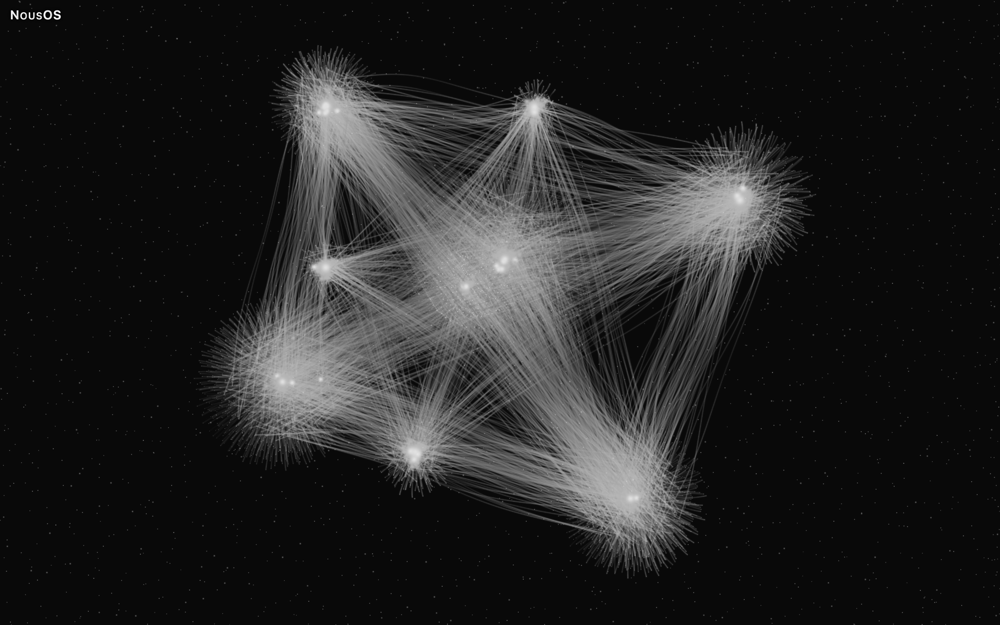](docs/assets/gallery/natural-stellar-3d-complete.jpg)

## What NousOS does

Notes and search can surface a claim while losing where it came from, when it applied, or whether later evidence superseded it. NousOS is a Python library with a local command line, stdio JSON-RPC interface, and browser graph review page. It connects verifiable memory—citations to exact source bytes and human-gated promotion—with visual exploration of the same knowledge as a graph: the graph is projected from the cited records, so its nodes and relations keep their evidence links and review details. You can open the synthetic demo graph in a browser and follow a short memory walkthrough on a synthetic corpus.

- Search returns readable hits, including for questions with punctuation; context can be retrieved around a hit.
- Citations identify byte ranges in immutable snapshots, so quoted text can be checked against the stored source bytes.
- Claims retain valid time (when they applied) and recording time (when learned); superseded claims remain in history and disagreements appear as conflicts.
- A proposal never becomes canon automatically. A person decides whether to promote it through a separate review action.
- Attested connections are backed by cited records. Exploratory connections are inferences with explanations; drawing one does not make it evidence.
- Explore the graph across Natural and experimental Geometry Lab topologies, three node morphologies, 2D and 3D views, and density presets.
- This repository contains synthetic data only. It does not include a private corpus.
- Local by default: store locations come from configuration, nothing guesses where a corpus lives, the command line and stdio JSON-RPC open no network listener, and the review page serves only on loopback.

## What V1 implements

| Area | Implemented capability |
|---|---|
| Canonical storage | Stable identity, immutable snapshots, append-only ingest history, citations, and assertion versions. |
| Derived state | Rebuildable full-text index and optional semantic index. |
| Time and evidence | Provenance, two time axes, supersession history, and visible disagreement. |
| Human control | Candidate proposals, discovery, adjudication, and separate human review for promotion. |
| Context | Deterministic context compilation with recorded inputs. |
| Interfaces | Command line and stdio JSON-RPC from one operation catalogue. |
| Projections | Renderer-independent graph projections and validated review dataset builder/server. |
| Visual review | 2D/3D, Natural and four experimental topologies, Indra organization, three morphologies, density controls, and relation readings. |
| Demo | Seeded synthetic knowledge base generator and review-page dataset. |


## Gallery

The interface labels are Italian: «Essenziale» means Essential, «Bilanciata» means Balanced, «Completa» means Complete; «Attestata» means Attested and «Esplorativa» means Exploratory.

The gallery uses invented demo data. Each pair is captured in the same page session and orientation; each density is framed by the page's fit. Balanced has its own layout, 7–10× more compact than Complete in these captures, measured from the manifest's layout bounds.

### Natural · Stellar overviews

| View | Balanced | Complete |
|---|---|---|
| 2D | [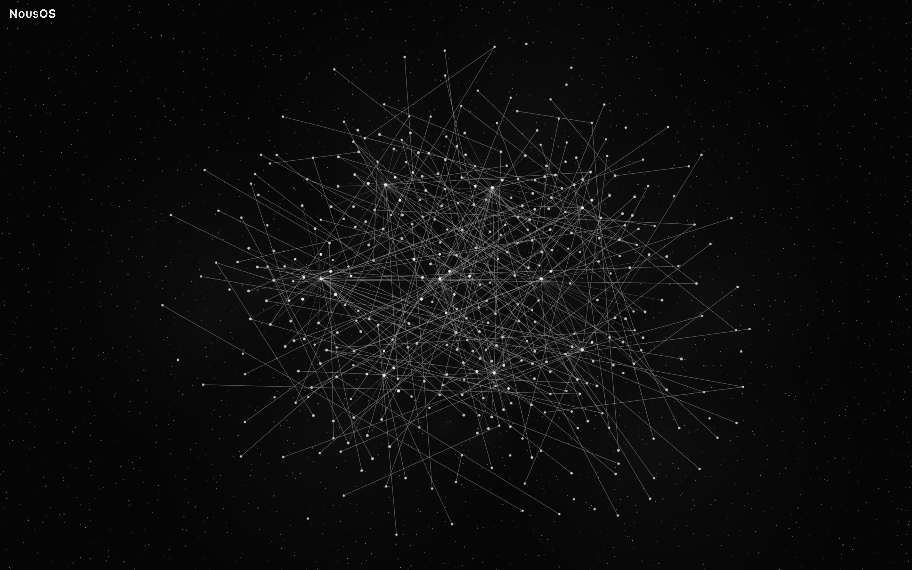](docs/assets/gallery/natural-stellar-2d-balanced.jpg) | [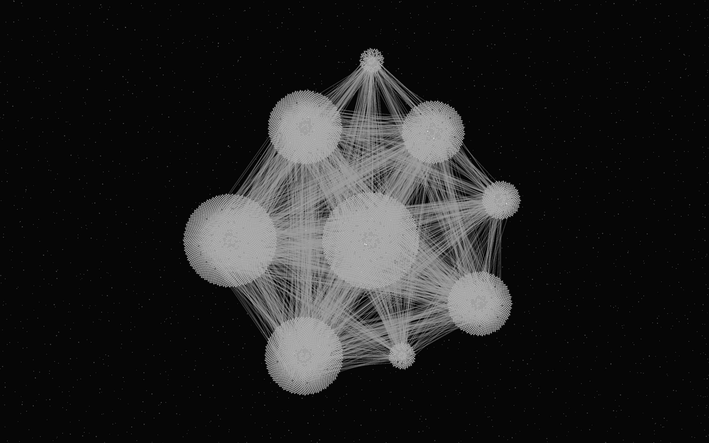](docs/assets/gallery/natural-stellar-2d-complete.jpg) |
| 3D | [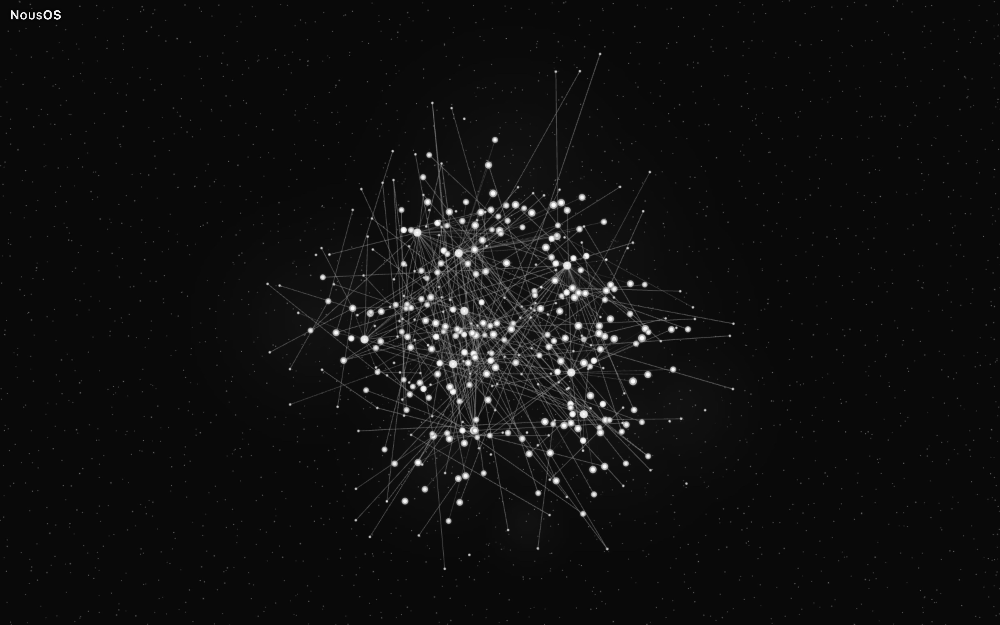](docs/assets/gallery/natural-stellar-3d-balanced.jpg) | [](docs/assets/gallery/natural-stellar-3d-complete.jpg) |

### Explore at different scales

Close-ups use the page's own camera: a smaller cluster is zoomed with the mouse wheel, and one 3D view is first rotated by a short drag to show depth. Each image was captured at Complete after the render stabilised; nothing is cropped or enlarged, and the camera of every view is recorded in the manifest.

[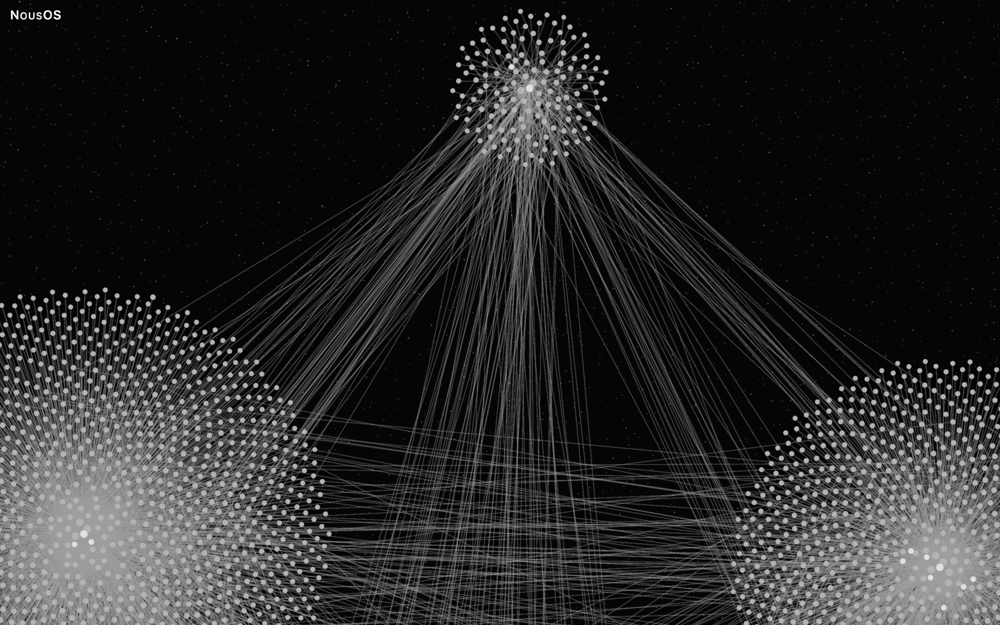](docs/assets/gallery/natural-stellar-2d-complete-detail-links.jpg)

Natural · Stellar · 2D · Complete, camera ×4.8 on a small cluster: its nodes and the relations fanning out to two large clusters.

[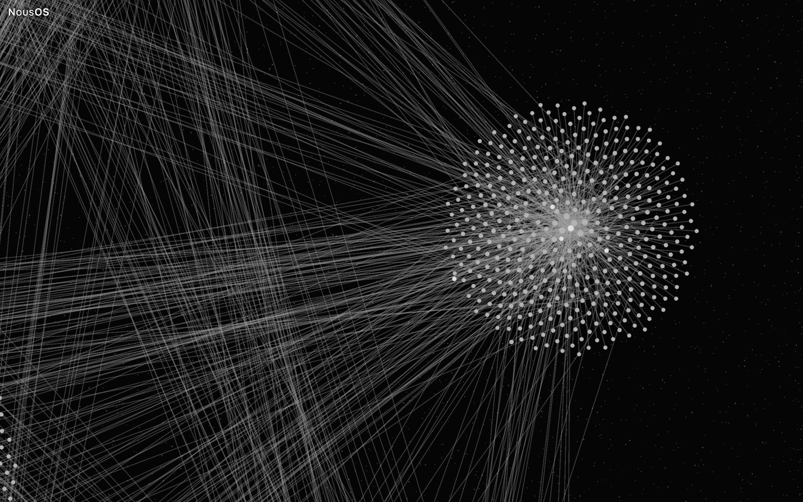](docs/assets/gallery/natural-stellar-2d-complete-detail-cluster.jpg)

Natural · Stellar · 2D · Complete, camera ×6.0 on a mid-sized cluster: individual nodes around its hub.

[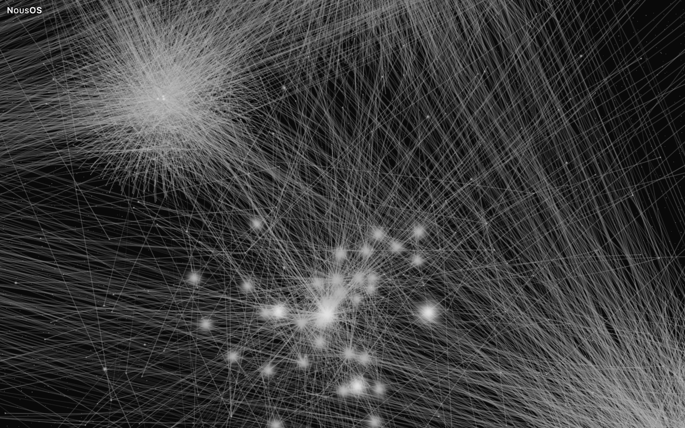](docs/assets/gallery/natural-stellar-3d-complete-detail-oblique.jpg)

Natural · Stellar · 3D · Complete, rotated by a short drag, camera ×4.5 on a mid-sized cluster, with a larger cluster behind it.

[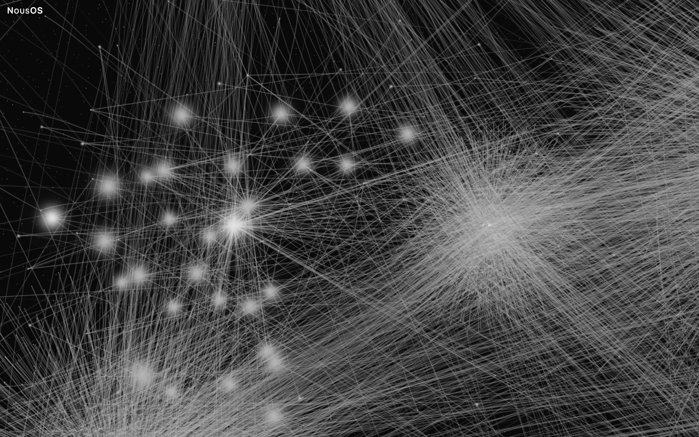](docs/assets/gallery/natural-stellar-3d-complete-detail-cluster.jpg)

Natural · Stellar · 3D · Complete, camera ×5.5 on a small cluster: its nodes and their relations, with a neighbouring hub at the right.

### Other topologies at Complete · experimental Geometry Lab

All images use synthetic demo data. Canopy, Sierpiński, Llull, and Julia are experimental topologies.

| Topology | 2D | 3D |
|---|---|---|
| Canopy | [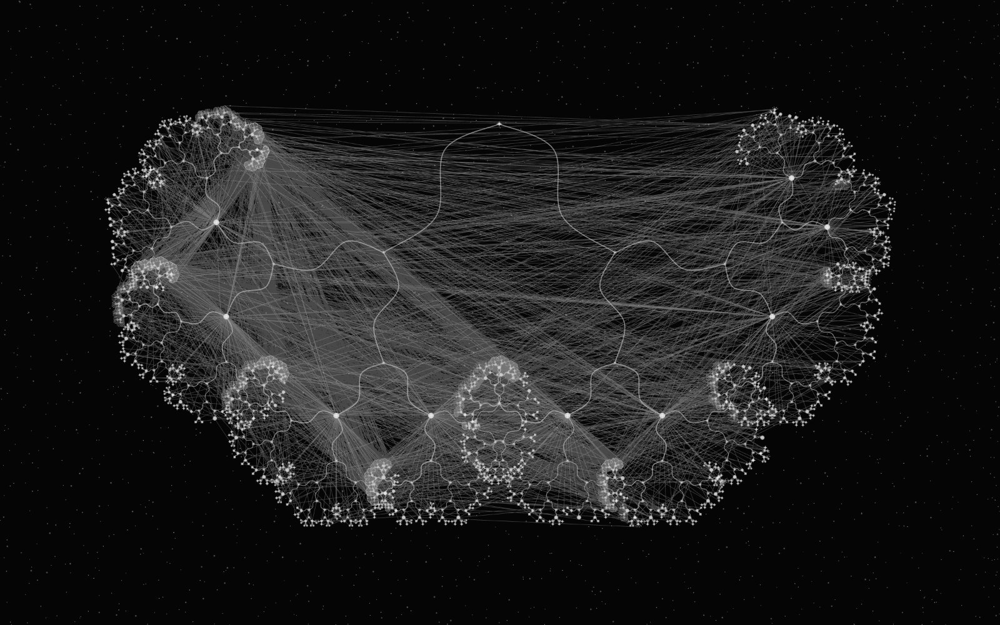](docs/assets/gallery/canopy-2d-complete.jpg)<br>Canopy · 2D · Complete | [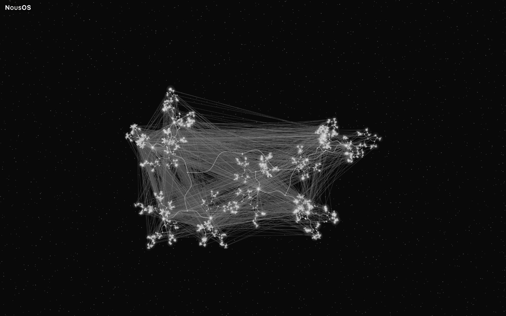](docs/assets/gallery/canopy-3d-complete.jpg)<br>Canopy · 3D · Complete |
| Sierpiński | [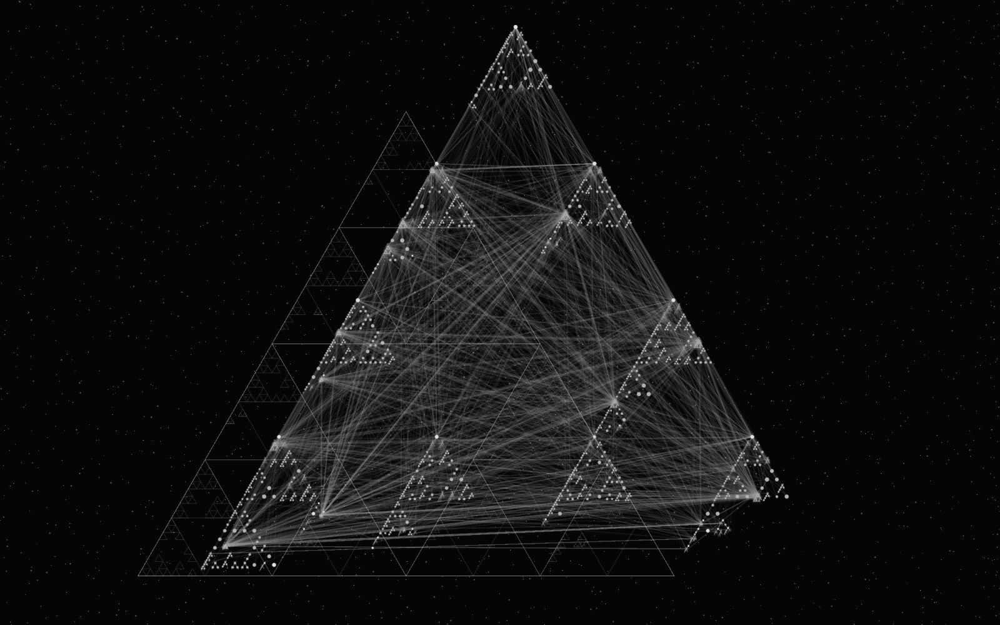](docs/assets/gallery/sierpinski-2d-complete.jpg)<br>Sierpiński · 2D · Complete | [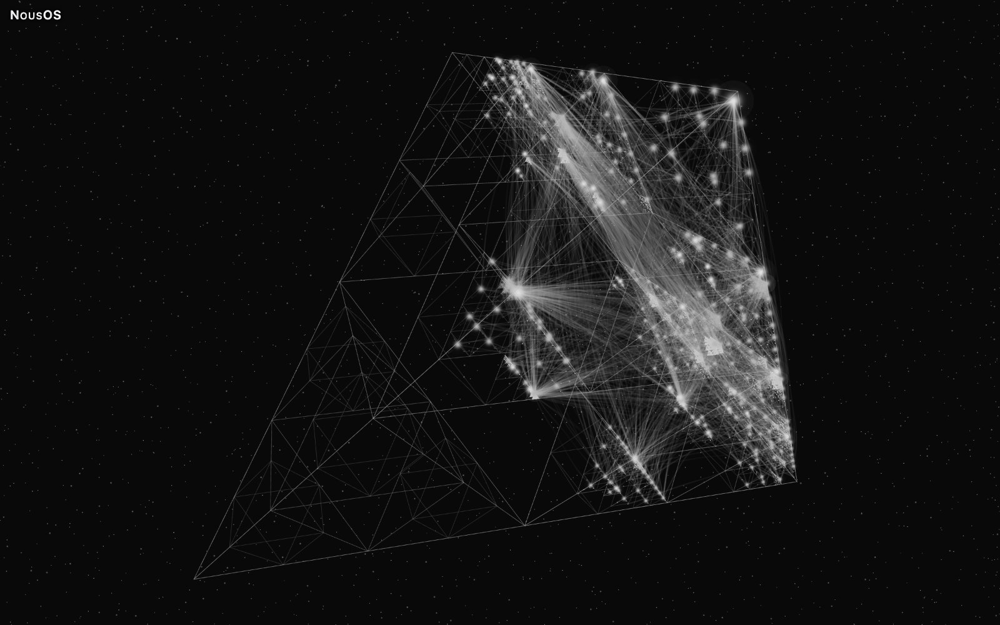](docs/assets/gallery/sierpinski-3d-complete.jpg)<br>Sierpiński · 3D · Complete |
| Llull | [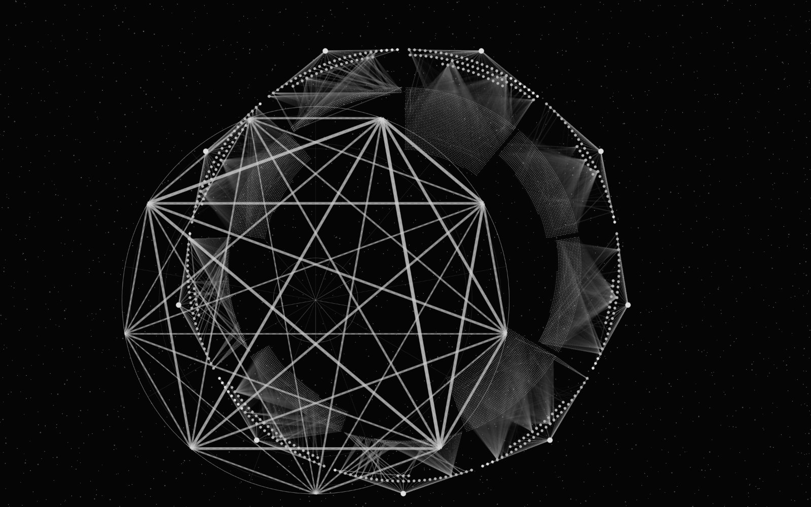](docs/assets/gallery/llull-2d-complete.jpg)<br>Llull · 2D · Complete | [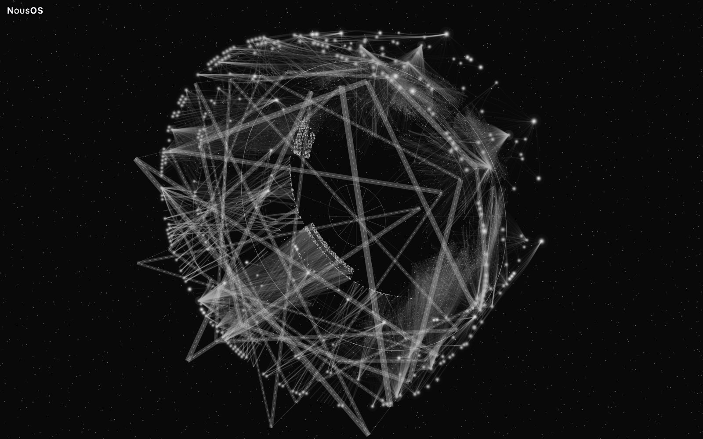](docs/assets/gallery/llull-3d-complete.jpg)<br>Llull · 3D · Complete |
| Julia | [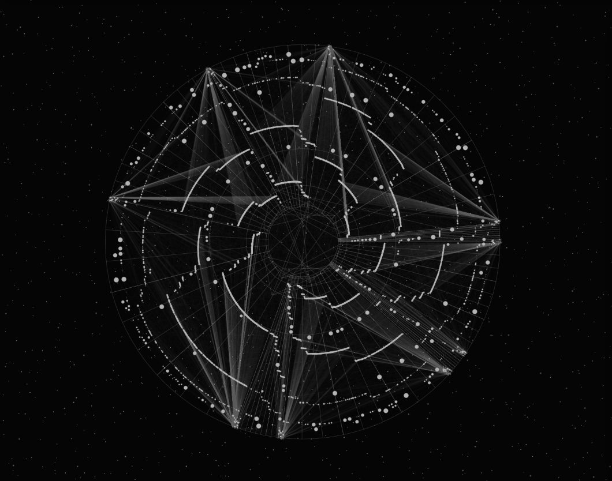](docs/assets/gallery/julia-2d-complete.jpg)<br>Julia · 2D · Complete | [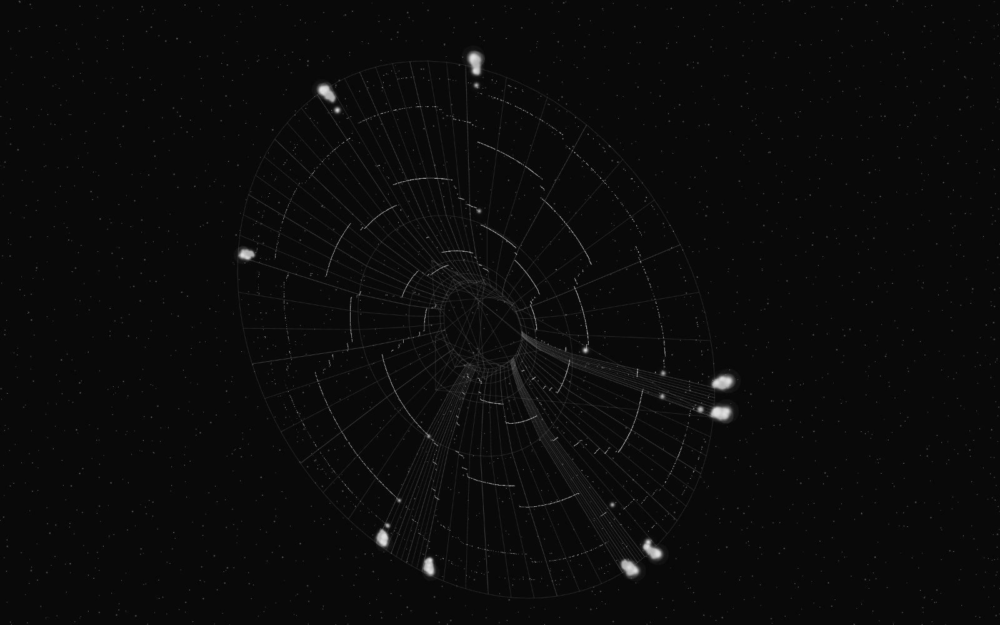](docs/assets/gallery/julia-3d-complete.jpg)<br>Julia · 3D · Complete (camera ×1.16 closer than the fitted view, where the relation bundles become visible) |

Capture method, render times, density counts, and size-coherence measurements are in [Gallery and measurements](docs/GALLERY-AND-MEASUREMENTS.md).

## Quickstart: public demo

The demo requires **Node.js 24** and **Python 3.11 or newer**. From the repository root, run:

```bash
npm --prefix ui ci
npm --prefix ui run build:review
node --experimental-strip-types demo/src/cli.ts synth --profile reference --seed 1 --out demo/out/reference
PYTHONPATH=src python3 -m nous_os.graph_review serve --graph demo/out/reference/dataset --port 8766
```

The Python package has no third-party runtime dependencies, so `PYTHONPATH=src` runs it from the checkout. Open <http://127.0.0.1:8766/#experimental=fractal>. The flag enables the experimental Geometry Lab topologies; without it, the page offers the Natural topology with optional Indra organization. The seeded generator creates invented labels, statements, citations, and passages, then validates the dataset before the review server serves it on loopback. For source ingestion, search, context, and byte-checked citation resolution, follow the [synthetic memory walkthrough](docs/MEMORY-WALKTHROUGH.md).

## Architecture

Canonical plain files are authoritative; snapshots and the append-only ledger feed cited assertions with two time axes. Rebuildable indexes support search, candidates require human review, and a deterministic compiler creates context packs; renderer-independent projections carry the knowledge into the graph view.

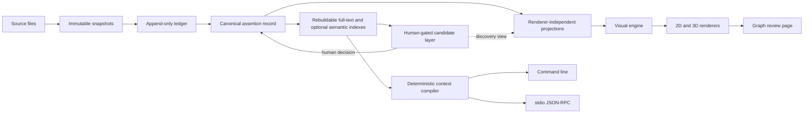

The command line and stdio JSON-RPC share an operation catalogue, and a proposal cannot become canonical through either. The graph view draws with Sigma over WebGL in 2D and Three.js with React Three Fiber in 3D. Identifiers, citations, quoted byte spans, and both time axes stay attached to records, so changing a layout changes none of them. The review page reads a validated dataset and does not add semantic relations; visual containers, bundles, and geometric guides help read the drawing but add no source relations.

## Verification and limits

- **Verified in CI:** the Python suite, typecheck, repository checks, and the commit contract over history. [Verification details](docs/VERIFICATION-AND-LIMITS.md)
- **Measured on the synthetic demo:** all 60 view configurations reached Complete, and 46 of them kept sampled node sizes within 1% across presets; exceptions include about 2× in 2D Canopy without Indra, up to 23% in 3D Sierpiński, Llull and Canopy with Indra, and up to 57% for one 2D Natural sample. [Full matrix](docs/GALLERY-AND-MEASUREMENTS.md)
- **Measured on the synthetic demo:** 440 of 561 sampled clicks selected the intended node. Dense views can select a neighbour. [Measurement details](docs/GALLERY-AND-MEASUREMENTS.md)
- **Observed on a larger private dataset:** five 3D views were not certified within the 90-second probe; of the 54 views that mounted, 40 kept sampled node sizes within 1% across presets. [Limit details](docs/VERIFICATION-AND-LIMITS.md)
- **Observed on the same private dataset:** after choosing Complete on a large 3D view, the density control and URL can update after drawing completes.
- **Measured on a private evaluation corpus:** six assembly-strategy families were compared; five were measured and none beat the plain default, and the sixth is recorded as unmeasured rather than as a tie ([details](docs/VERIFICATION-AND-LIMITS.md#context-compilation)).
- **Known limit:** `npm --prefix ui run test:unit` fails from a clean clone in four document suites because generated evidence is absent. [Verification details](docs/VERIFICATION-AND-LIMITS.md)
- **Known limits:** semantic tests need local ONNX checkpoints; Chromium is the only browser verified; touch, keyboard navigation inside the canvas, and screen readers are unverified. [Full list](docs/VERIFICATION-AND-LIMITS.md)
- **Not certified:** GPU-backed browser evidence and visual acceptance are not CI checks; six visual acceptance criteria need human inspection.
- **Other limits:** topology preconditions and certificates, clipping, density calibration, rendering stalls, and the remaining known constraints are listed in [Verification and limits](docs/VERIFICATION-AND-LIMITS.md).

## Repository layout

| Path | Contents |
|---|---|
| `src/nous_os/` | Canonical records, indexing, compilation, transports, and graph projections. |
| `ui/src/` | Visual engine, review page, topologies, and 2D/3D renderers. |
| `ui/test/` | UI unit, renderer, and browser suites. |
| `demo/` | Synthetic dataset generator and its tests. |
| `tests/` | Python test suite. |
| `docs/` | Architecture, interface, retrieval, renderer, review, gallery, and verification documentation. |
| `docs/assets/gallery/` | Review-page captures and their manifest. |

<details><summary>Full repository layout</summary>

```text
src/
└── nous_os/
    ├── __init__.py
    ├── __main__.py
    ├── ablation.py
    ├── adjudication.py
    ├── aliases.py
    ├── artifact.py
    ├── assistant_export.py
    ├── attribution.py
    ├── candidate_search.py
    ├── candidates.py
    ├── canonical.py
    ├── capability.py
    ├── capture_bundle.py
    ├── chunking.py
    ├── cli.py
    ├── compile.py
    ├── config.py
    ├── core.py
    ├── derived.py
    ├── discovery.py
    ├── extraction.py
    ├── graph_drawer.py
    ├── graph_review.py
    ├── graph_view.py
    ├── identity.py
    ├── ledger.py
    ├── mapping_export.py
    ├── mcp.py
    ├── measure.py
    ├── operations.py
    ├── projection.py
    ├── provenance.py
    ├── reconciliation.py
    ├── review.py
    ├── review_graph.py
    ├── semantic.py
    ├── semantic_index.py
    ├── snapshots.py
    ├── sources.py
    ├── temporal.py
    ├── text_projection.py
    └── untrusted.py
```

</details>

## Documentation

- [Memory walkthrough on a synthetic corpus](docs/MEMORY-WALKTHROUGH.md)
- [Gallery and measurements](docs/GALLERY-AND-MEASUREMENTS.md)
- [Verification and limits](docs/VERIFICATION-AND-LIMITS.md)
- [Vocabulary](docs/VOCABULARY.md)
- [Interoperability and transports](docs/INTEROPERABILITY.md)
- [Renderer comparison](docs/RENDERER-COMPARISON.md)
- [2D/3D comparison](docs/CAP-14-COMPARISON.md)
- [Retrieval measurement](docs/CAP-15-RETRIEVAL.md)
- [Graph review export and page](docs/GRAPH-REVIEW.md)
- [Graph viewer](docs/GRAPH-VIEWER.md)
- [Candidate search](docs/CANDIDATE-SEARCH.md)
- [View architecture](docs/views/architecture.md)
- [View manual](docs/views/manual.md)
- [Geometry Lab](docs/views/GEOMETRY-LAB.md)
- [Deferred views](docs/views/deferred-views.md)
- [View limits](docs/views/limits.md)
- [Synthetic demo and dataset schema](demo/README.md)

## Contributing

See [CONTRIBUTING.md](CONTRIBUTING.md) for development setup and repository contribution conventions.

## License

MIT. See [LICENSE](LICENSE).
