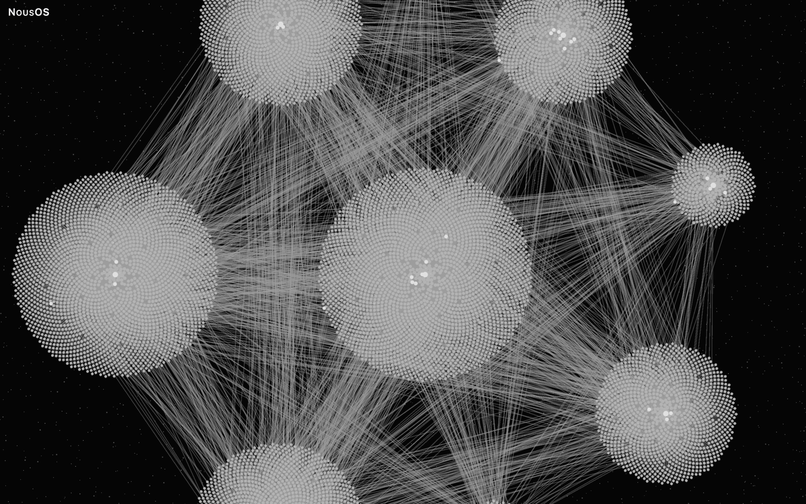
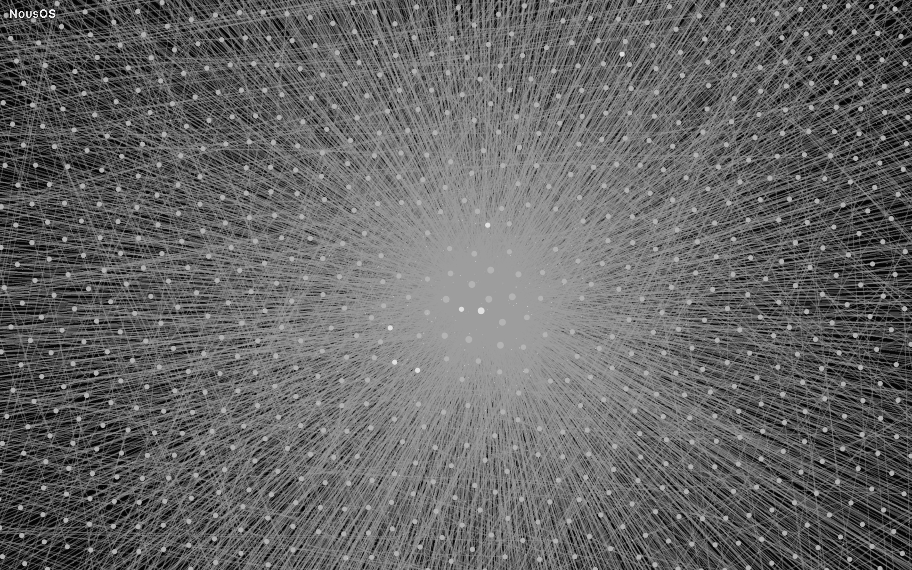
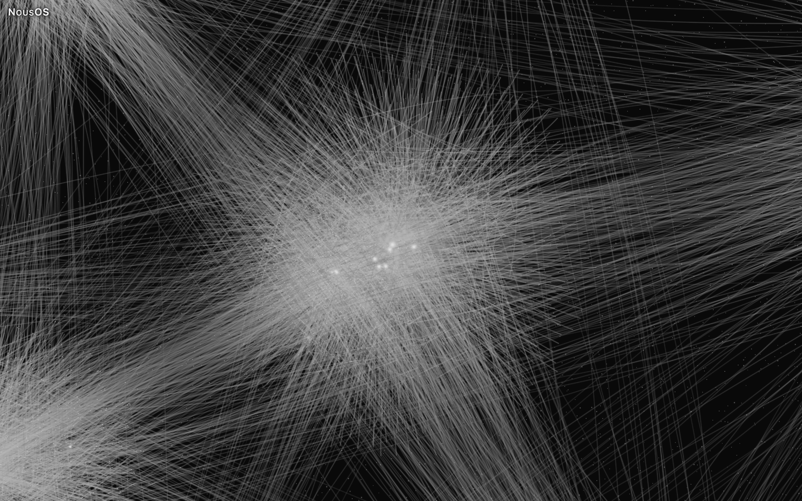
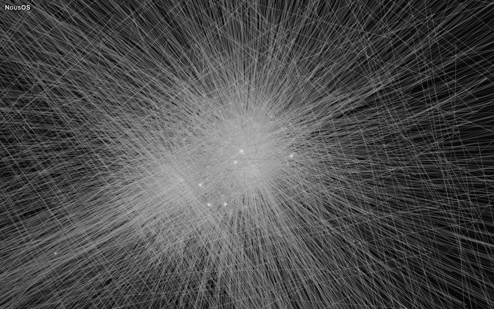
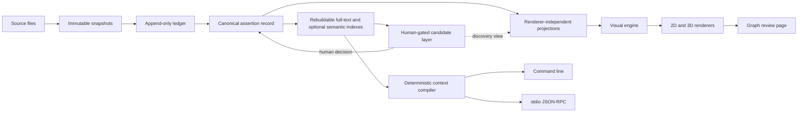

# NousOS

A local-first knowledge system that turns source files into searchable, reviewable memory with citations tied to their original bytes.

[](docs/assets/gallery/natural-stellar-3d-complete.jpg)

## The problem and the concrete use

Ordinary notes and search can find a phrase while leaving you to reconstruct where a claim came from, when it applied, whether it was later superseded, and what other evidence disagrees. NousOS keeps source snapshots, claims, time, citations, and review decisions connected, so you can search a local corpus, inspect the evidence around a result, compile reproducible context, and explore relationships in a graph.

NousOS is a Python library with a local command line and stdio JSON-RPC interfaces, plus a browser-based graph review page. It is not a hosted service or chat product: callers choose when to invoke operations. No operation promotes a proposal (a candidate claim) into canon (the authoritative record); a person makes that decision through a separate review path. The graph review page serves on loopback for local browser access. Retrieval measurements and limits are documented in [retrieval measurement](docs/CAP-15-RETRIEVAL.md).

## Queryable memory, context retrieval, and verifiable provenance

The rebuildable full-text index searches canonical records. If a query has a syntax error, search retries once with its words, so natural-language questions with punctuation can still return results. An optional semantic index can also be built from locally available model files; it is derived, rebuildable, and reported as not run when required material is absent. Neither index replaces source records or citations.

A search hit retains source and snapshot identifiers and returns readable text with metadata such as kind, role, creation time, and title when present. The context compiler takes ranked material and emits a reproducible context pack with a record of its inputs. Six assembly-strategy families were compared on a private evaluation corpus: five were measured and none beat the plain strategy, which is the default; the sixth could not be measured on that corpus and is recorded as unmeasured rather than as a tie (see `DEFAULT_STRATEGY` in <code>src&#47;nous_os&#47;compile.py</code>). Evaluation distinguishes including a source pair from including the cited passages. Retrieval arms are compared separately in the recorded [retrieval measurement](docs/CAP-15-RETRIEVAL.md).

Source files are captured as immutable, content-addressed snapshots, with an append-only ingest ledger. A citation points to a snapshot and byte range, so the quoted span can be checked against the exact source bytes. Re-ingesting unchanged bytes does not create a new content version. Assertions retain valid time (when a claim applied) and recording time (when the system learned it); superseded claims stay in history, and disagreements are exposed as conflicts rather than silently resolved.

## Attested and exploratory connections

**Attested** connections are relations backed by cited records. **Exploratory** connections are non-canonical inferences, each with an explanation. The review page keeps these readings distinct: an inference does not become cited evidence because it is drawn. **Combined** shows both classes. The «Essenziali» / «Tutte» relation-detail control selects essential or all eligible relations under the active reading.

Proposals, discovery results, adjudications, and rejections are stored separately from canonical assertions. Their presence does not change canon. The graph projection carries typed node and relation classes, evidence links, and review details to the renderer; visual containers, bundles, and geometric guides help read the drawing but do not add source relations.

## Visual graph exploration

The read-only review page explores a validated dataset in 2D or 3D. Topology determines where nodes are placed; morphology determines how nodes and edges are drawn. All five topologies support both dimensions:

- **Natural** arranges the primary hierarchy deterministically around root domains.
- **Canopy** applies an iterated function system (IFS) tree with curved rails.
- **Sierpiński** uses an affine IFS: a triangular gasket in 2D and tetrahedral dust in 3D.
- **Llull** implements the circular-combinatorial Figure A and requires exactly nine root domains. Its 3D height is the Third Figure's offset class.
- **Julia** places nodes in external coordinates of certified quadratic or cubic dynamics. Its 3D height is a scalar lift of the external potential G, not a 3D Julia set.

The Geometry Lab topologies are experimental and are enabled in the demo with `#experimental=fractal`. Each topology checks its preconditions and refuses input it cannot place faithfully. **Indra** is an optional organization that groups a supported topology into nested containers called pearls. A pearl counts hidden nodes, and opening it reveals its real children; Indra changes the organization of the view, not the dataset's relations. Julia with Indra is refused when its atlas cannot be certified legible at its mounted scale.

The three morphologies are **Stellar** (luminous points and filaments), **Neural** (somata and neural-style connections), and **Mycelium** (branching network-like forms). Neural's optional «Cervello» control adds a decorative brain outline in 3D. In Natural, morphology also selects the default arrangement: Stellar uses constellation, Neural uses network, and Mycelium uses mycelium. In other topologies, placement follows the selected topology law; morphology does not change meaning.

Density controls select how much of the graph is drawn. In Natural 2D, the gallery manifest records 80 / 11,199 nodes for «Essenziale», 400 / 11,199 for «Bilanciata», and 11,199 / 11,199 for «Completa». «Completa» draws every node. **Custom** requests a chosen number of real nodes. Status distinguishes visible from represented nodes and reports drawn and eligible relations; a requested budget is not a guarantee of the actual visible count. At «Completa», dense 3D views draw every node and every relation selected by the relation-detail control. With this build, 3D «Completa» was also reached in a browser in all five topologies on larger synthetic datasets of 15,000 and 20,000 nodes (up to 25,111 drawn relations); the published demo profiles do not generate these sizes.

### Natural · Stellar gallery

The gallery uses the synthetic demo dataset, whose content is invented. Captures use the page's fullscreen view, where only the NousOS title stays visible at the top left; node labels, panels, tooltips, selections and controls are hidden. Each pair is captured in one page session: only the density control changes, the orientation is kept, and the page frames each density with its own fit. «Bilanciata» has its own layout, 7 to 10 times more compact than «Completa» in these captures (measured from the layout bounds recorded in the manifest), so an identical camera would show it as a small cluster. Both camera states are recorded in the manifest.

[](docs/assets/gallery/natural-stellar-2d-balanced.jpg)

Natural · Stellar · 2D · Bilanciata — synthetic demo data.

[](docs/assets/gallery/natural-stellar-2d-complete.jpg)

Natural · Stellar · 2D · Completa — synthetic demo data.

[](docs/assets/gallery/natural-stellar-3d-balanced.jpg)

Natural · Stellar · 3D · Bilanciata — synthetic demo data.

[](docs/assets/gallery/natural-stellar-3d-complete.jpg)

Natural · Stellar · 3D · Completa — synthetic demo data.

### Explore at different scales

The cluster at the centre of the «Completa» overviews above, from an intermediate zoom down to its inner nodes. Each image comes from zooming the page's camera on that cluster at «Completa» and waiting for the render to stabilise; nothing is cropped or enlarged. Magnifications are relative to the fitted overview and recorded in the manifest.

[](docs/assets/gallery/natural-stellar-2d-complete-zoom-mid.jpg)

Natural · Stellar · 2D · Completa, camera ×2.0: the cluster among its neighbours, with individual nodes already distinguishable — synthetic demo data.

[](docs/assets/gallery/natural-stellar-2d-complete-zoom-deep.jpg)

Natural · Stellar · 2D · Completa, camera ×11.6: inside the cluster, individual nodes and the relations converging on its hub — synthetic demo data.

[](docs/assets/gallery/natural-stellar-3d-complete-zoom-mid.jpg)

Natural · Stellar · 3D · Completa, camera ×3.0: the same cluster and the relations that reach it — synthetic demo data.

[](docs/assets/gallery/natural-stellar-3d-complete-zoom-deep.jpg)

Natural · Stellar · 3D · Completa, camera ×11.0: inside the cluster, its brightest nodes within dense relations — synthetic demo data.

### Other topologies at «Completa» (experimental Geometry Lab)

The following captures also use synthetic demo data. Counts are the values recorded in `MANIFEST.json`.

| Topology | 2D | 3D |
|---|---|---|
| Canopy | [](docs/assets/gallery/canopy-2d-complete.jpg)<br>Canopy · 2D · Completa | [](docs/assets/gallery/canopy-3d-complete.jpg)<br>Canopy · 3D · Completa |
| Sierpiński | [](docs/assets/gallery/sierpinski-2d-complete.jpg)<br>Sierpiński · 2D · Completa | [](docs/assets/gallery/sierpinski-3d-complete.jpg)<br>Sierpiński · 3D · Completa |
| Llull | [](docs/assets/gallery/llull-2d-complete.jpg)<br>Llull · 2D · Completa | [](docs/assets/gallery/llull-3d-complete.jpg)<br>Llull · 3D · Completa |
| Julia | [](docs/assets/gallery/julia-2d-complete.jpg)<br>Julia · 2D · Completa | [](docs/assets/gallery/julia-3d-complete.jpg)<br>Julia · 3D · Completa |

### Recorded render times

`completeMs` measures time from a fresh page until the renderer's readiness status reports «completa», meaning every requested node and edge is drawn at full quality. Captures were measured on one machine and browser: headless Chromium 151 (ANGLE Metal backend) on an Apple-silicon Mac (darwin arm64). These measurements do not characterize other machines or browsers.

| Gallery view | Time to «Completa» |
|---|---:|
| Natural · 2D | 4.5 s |
| Natural · 3D | 3.1 s |
| Canopy · 2D | 2.4 s |
| Canopy · 3D | 2.4 s |
| Sierpiński · 2D | 3.3 s |
| Sierpiński · 3D | 2.7 s |
| Llull · 2D | 3.3 s |
| Llull · 3D | 2.7 s |
| Julia · 2D | 5.3 s |
| Julia · 3D | 4.7 s |
| Neural · 3D · «Cervello» | 7.2 s |
| Mycelium · 2D | 5.6 s |
| «Esplorativa» · 3D | 2.7 s |
| Natural · 2D · «Essenziale» | 1.5 s |
| Natural · 2D · «Bilanciata» | 1.6 s |
| Whole page | 3.2 s |

In the paired captures, switching the same page from «Completa» to «Bilanciata» reached «completa» readiness (every requested node and edge drawn at full quality) in 1.4 s (2D) and 0.8 s (3D). Canopy, Sierpiński, Llull and Julia are experimental Geometry Lab topologies.

## Essential architecture

Canonical plain files are authoritative. Immutable source snapshots and the append-only ledger feed canonical assertions with citations and two time axes. Full-text and optional semantic indexes are derived and rebuildable. Candidate proposals remain separate until human review; the context compiler produces reproducible packs from ranked material. One operation catalogue serves the command line and stdio JSON-RPC. Renderer-independent projections feed the visual engine, then Sigma over WebGL for 2D and Three.js with React Three Fiber for 3D. The review page reads its dataset and does not add semantic relations.



A proposal cannot become canonical through either transport. Canonical updates require a distinct human review action. Stable identifiers, citations, quoted byte spans, valid time, and recording time remain attached to records; changing a visual layout does not change them.

## Quickstart: public demo

The demo requires **Node.js 24** and **Python 3.11 or newer**. From the repository root, run:

```bash
npm --prefix ui ci
npm --prefix ui run build:review
node --experimental-strip-types demo/src/cli.ts synth --profile reference --seed 1 --out demo/out/reference
PYTHONPATH=src python3 -m nous_os.graph_review serve --graph demo/out/reference/dataset --port 8766
```

The Python package has no third-party runtime dependencies, so `PYTHONPATH=src` runs it from the checkout.

Open <http://127.0.0.1:8766/#experimental=fractal>. The URL flag enables the Geometry Lab topologies; without it, the page offers Natural and Indra. Seed 1 of the `reference` profile produces the dataset digest recorded in [the gallery manifest](docs/assets/gallery/MANIFEST.json). The profile's counts are illustrative except for its fixed node total and root-domain count. The generator uses seeded invented labels, statements, citations, and passages; it does not need an external corpus. Its validator checks the generated dataset before the review server serves it on loopback.

## Try the memory on the synthetic corpus

From the repository root, this example ingests the shipped Markdown files through the public Python API, builds the derived index, searches it, reads context for a result, and resolves a citation to the exact bytes of a hash-checked snapshot. The CLI defaults to read access; ingestion here uses the library's public `nous_os.ledger.ingest` function.

```bash
WORKSPACE="$(mktemp -d)"
export WORKSPACE
mkdir -p "$WORKSPACE/snapshots"
export PYTHONPATH=src
export NOUS_OS_DATA_ROOT=fixtures/synthetic/corpus
export NOUS_OS_SNAPSHOT_ROOT="$WORKSPACE/snapshots"
export NOUS_OS_LEDGER_PATH="$WORKSPACE/ledger.jsonl"
export NOUS_OS_DERIVED_PATH="$WORKSPACE/derived.sqlite3"
export NOUS_OS_CANDIDATE_STORE_PATH="$WORKSPACE/candidates.jsonl"
export NOUS_OS_BRIDGE_REGISTRY_PATH="$WORKSPACE/bridges.jsonl"
export NOUS_OS_REJECTION_MEMORY_PATH="$WORKSPACE/rejections.jsonl"
export NOUS_OS_RELATION_STORE_PATH="$WORKSPACE/relations.jsonl"

python3 - <<'PY'
from datetime import datetime, timezone
import os
from pathlib import Path
from nous_os.identity import new_source_id
from nous_os.ledger import Ledger, ingest
from nous_os.snapshots import SnapshotStore
from nous_os.untrusted import UntrustedText

root = Path(os.environ["NOUS_OS_DATA_ROOT"])
snapshots = SnapshotStore(Path(os.environ["NOUS_OS_SNAPSHOT_ROOT"]))
ledger = Ledger(Path(os.environ["NOUS_OS_LEDGER_PATH"]))
files = sorted(root.rglob("*.md"))
for path in files:
    ingest(snapshots, ledger, new_source_id(),
           UntrustedText(path.read_text(encoding="utf-8")),
           datetime.now(timezone.utc))
print(f"Ingested {len(files)} synthetic Markdown files.")
PY

python3 -m nous_os.derived rebuild --snapshot-root "$NOUS_OS_SNAPSHOT_ROOT" --ledger-path "$NOUS_OS_LEDGER_PATH" --derived-path "$NOUS_OS_DERIVED_PATH"

python3 -m nous_os knowledge.search --query "How many metres do spring tides at Kestrel Bay reach?" --limit 3 | tee "$WORKSPACE/search.json"

python3 - <<'PY'
import json
import os
from pathlib import Path
from nous_os.snapshots import SnapshotStore

workspace = Path(os.environ["WORKSPACE"])
hits = json.loads((workspace / "search.json").read_text(encoding="utf-8"))
phrase = b"spring tides reaching five"
for hit in hits:
    snapshot = SnapshotStore(Path(os.environ["NOUS_OS_SNAPSHOT_ROOT"])).get(
        hit["source_id"], hit["snapshot_digest"])
    start = snapshot.data.find(phrase)
    if start >= 0:
        citation = {
            "source_id": hit["source_id"],
            "snapshot_digest": hit["snapshot_digest"],
            "start_byte": start,
            "end_byte": start + len(phrase),
            "span": phrase.decode("utf-8"),
        }
        (workspace / "citation.json").write_text(
            json.dumps(citation), encoding="utf-8")
        (workspace / "hit-source-id").write_text(
            hit["source_id"], encoding="utf-8")
        print("Built a citation from the search hit and its stored snapshot.")
        break
else:
    raise SystemExit("No search hit contained the example citation span.")
PY

python3 -m nous_os knowledge.context --source-id "$(cat "$WORKSPACE/hit-source-id")"

python3 -m nous_os provenance.span --citation "$(cat "$WORKSPACE/citation.json")"

python3 -m nous_os system.capabilities
python3 -m nous_os system.health

printf '%s\n' \
  '{"jsonrpc":"2.0","id":1,"method":"initialize","params":{}}' \
  '{"jsonrpc":"2.0","id":2,"method":"tools/list","params":{}}' \
  '{"jsonrpc":"2.0","id":3,"method":"tools/call","params":{"name":"system.health","arguments":{}}}' \
  | python3 -m nous_os.mcp
```

The ingest step prints `Ingested 4 synthetic Markdown files.`, and `provenance.span` prints the bytes at the cited range, `"spring tides reaching five"`, which match the citation's quoted text.

The search question includes punctuation to exercise the full-text fallback. The citation names the exact byte range for `spring tides reaching five` in one hit's snapshot; `provenance.span` loads that snapshot, checks its content hash and the byte range, and prints the bytes at that range; comparing them with the quoted text confirms the citation. The snippet demonstrates source retrieval; it is not an assertion promoted to canon.

## Tests, known limits, and privacy

The Python suite covers canonical records, provenance, ingestion, derived indexes, candidate gates, temporal behavior, projections, and package contracts. Demo-generator tests cover deterministic output, canonical JSON, one index edge per real relation, and validator acceptance. UI unit tests exercise topology laws, density and relation selection, focus, panels, labels, appearance, and render scheduling; renderer suites cover 2D/3D drawing contracts and interactions. Browser evidence suites cover page opening and rendered interactions when the required browser and GPU environment is available. Not every browser or visual evidence suite runs in default CI.

The reproducible public Python and typecheck commands used by CI are:

```bash
python3 -m pip install pytest ".[semantic]"
npm --prefix ui ci
python3 -m pytest tests/ -q --ignore=tests/test_semantic.py --ignore=tests/test_semantic_controls.py
npm --prefix ui run typecheck
```

The two excluded semantic modules need local ONNX checkpoints; resolution is local-only. The semantic extra is installed because other package tests import that module. CI runs on Linux with the declared Python floor and a current Python version. It covers package installation and import, the Python suite, typecheck, repository hygiene checks, and the commit-message contract across repository history. It does not run GPU-backed browser evidence or visual acceptance review.

Recorded limits from a public clone:

- Browser suites require Playwright browsers and a real GPU adapter. They generate `ui/dist/`, which is run output and is not committed.
- `npm --prefix ui run test:unit` does not pass from a clean clone, even after `npm --prefix ui run build:review`; four document suites require generated evidence under `ui/dist/` and fail when it is absent.
- Semantic tests need locally cached ONNX checkpoints. With the semantic extra and an empty cache, the recorded run has failures and errors; no download is attempted.
- Six visual acceptance criteria require human inspection of rendered images.
- Only Chromium was verified for the review page. Touch devices, keyboard navigation inside the canvas, and screen readers were not verified.
- Node size is taken from the complete layout at every density preset («Essenziale», «Bilanciata», «Completa», Custom). In a browser matrix on the demo dataset (five topologies × three morphologies × 2D/3D × Indra on/off, 60 configurations, 5 to 21 sampled nodes each, identical camera), all 60 configurations reached «Completa», and 46 kept every sampled node within 1% of its «Completa» radius across presets. The exceptions are:
  - 2D Canopy without Indra, where the sparser presets draw nodes up to about twice their «Completa» size;
  - 3D Sierpiński, Llull and Canopy, Stellar with Indra, up to 23%;
  - 2D Natural and 2D Canopy with Indra, one sampled node each, up to 57% and 11%;
  - 3D Natural Stellar without Indra, up to 7.7% in drawn size: the node keeps its size, but each density's layout places it at a different depth;
  - 2D Natural Mycelium without Indra, 1.4%.
- In the same matrix, 440 of 561 sampled clicks (78%) selected the intended node; in dense views a click can select a neighbouring node.
- In 3D Julia with Indra, a node's glow halo can vary with which nodes the atlas admits; its core size and centre do not.
- Nodes outside the camera can be clipped.
- Llull requires exactly nine root domains.
- Julia with Indra is refused when the atlas cannot be certified legible at its mounted scale. With labels hidden, its legibility certificate can fail because the «+N» badges are hidden.
- Some «Completa» drawing calibrations are keyed to the demo's 11,199 nodes; other dataset sizes use general policies until those constants are parameterized.
- A second page drawing a heavy 3D view in the same browser can stall for several seconds. The first opening of a sparse Natural 3D view computes a full reference layout first.
- The per-node date table used by Canopy is empty in the demo, so dates are unknown unless a dataset supplies them.
- Llull, Indra compositions, and the Julia atlas are covered by their own runtime certificates.
- Code comments, test names, some documentation headings, and page test hooks and storage keys (for example `window.__d067`) carry short development step identifiers; they label development steps and reference no data.

Privacy is local by default: store locations come from configuration and NousOS does not guess a corpus location. The tracked fixtures and README gallery images use invented synthetic material. Indexes are derived and rebuildable, not the source of truth. Optional semantic indexing uses locally available model files. A corpus remains where you place it; this repository contains the software and synthetic examples. The command line and stdio JSON-RPC transports have no network listener; the separate review demo serves only on loopback.

## What V1 implements

| Area | Implemented capability |
|---|---|
| Canonical storage | Stable identity, immutable source snapshots, append-only ingest history, citations, and assertion versions. |
| Derived state | Rebuildable full-text index and optional semantic index. |
| Time and evidence | Provenance, two time axes, supersession history, and visible disagreement. |
| Human control | Candidate proposals, discovery, adjudication, and a separate human review path for promotion. |
| Context | Deterministic context compilation with recorded inputs. |
| Interfaces | Command line and stdio JSON-RPC from one operation catalogue. |
| Projections | Renderer-independent graph projections and a validated review dataset builder/server. |
| Visual review | 2D and 3D rendering, the Natural topology and four experimental Geometry Lab topologies, Indra organization, three morphologies, density controls, and relation readings. |
| Demo | Seeded synthetic knowledge base generator and review-page dataset. |

## Repository layout

| Path | Contents |
|---|---|
| `src/nous_os/` | Canonical records, indexing, compilation, transports, and graph projections. |
| `ui/src/` | Visual engine, review page, topologies, and 2D/3D renderers. |
| `ui/test/` | UI unit, renderer, and browser suites. |
| `demo/` | Synthetic dataset generator and its tests. |
| `tests/` | Python test suite. |
| `docs/` | Architecture, interface, retrieval, renderer, and review documentation. |
| `docs/assets/gallery/` | Review-page captures and their manifest. |

<details><summary>Full repository layout</summary>

```text
src/
└── nous_os/
    ├── __init__.py
    ├── __main__.py
    ├── ablation.py
    ├── adjudication.py
    ├── aliases.py
    ├── artifact.py
    ├── assistant_export.py
    ├── attribution.py
    ├── candidate_search.py
    ├── candidates.py
    ├── canonical.py
    ├── capability.py
    ├── capture_bundle.py
    ├── chunking.py
    ├── cli.py
    ├── compile.py
    ├── config.py
    ├── core.py
    ├── derived.py
    ├── discovery.py
    ├── extraction.py
    ├── graph_drawer.py
    ├── graph_review.py
    ├── graph_view.py
    ├── identity.py
    ├── ledger.py
    ├── mapping_export.py
    ├── mcp.py
    ├── measure.py
    ├── operations.py
    ├── projection.py
    ├── provenance.py
    ├── reconciliation.py
    ├── review.py
    ├── review_graph.py
    ├── semantic.py
    ├── semantic_index.py
    ├── snapshots.py
    ├── sources.py
    ├── temporal.py
    ├── text_projection.py
    └── untrusted.py
```

</details>


## Documentation

- [Vocabulary](docs/VOCABULARY.md)
- [Interoperability and transports](docs/INTEROPERABILITY.md)
- [Renderer comparison](docs/RENDERER-COMPARISON.md)
- [2D/3D comparison](docs/CAP-14-COMPARISON.md)
- [Retrieval measurement](docs/CAP-15-RETRIEVAL.md)
- [Graph review export and page](docs/GRAPH-REVIEW.md)
- [Graph viewer](docs/GRAPH-VIEWER.md)
- [Candidate search](docs/CANDIDATE-SEARCH.md)
- [View architecture](docs/views/architecture.md)
- [View manual](docs/views/manual.md)
- [Geometry Lab](docs/views/GEOMETRY-LAB.md)
- [Deferred views](docs/views/deferred-views.md)
- [View limits](docs/views/limits.md)
- [Synthetic demo and dataset schema](demo/README.md)

## Contributing

See [CONTRIBUTING.md](CONTRIBUTING.md) for development setup and repository contribution conventions.

## License

MIT. See [LICENSE](LICENSE).
